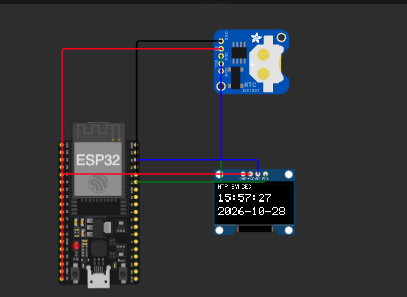
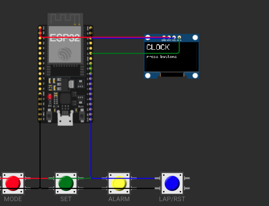
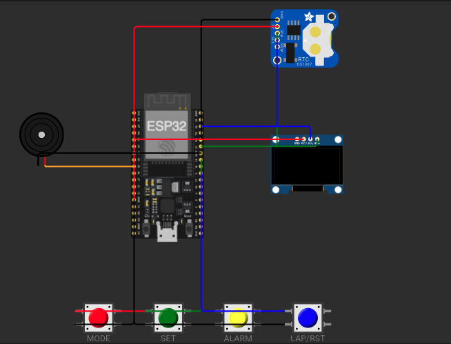

# รายงานผลการทดลอง: นาฬิกาดิจิทัล ESP32 แบบ Modular C++ OOP ด้วย ESP-IDF และ FreeRTOS บน Wokwi (Final Homework)

> Final Homework วิชา Applied Microcontroller
> สเปกโจทย์: [docs/wokwi_esp32_digital_clock_suite.html](docs/wokwi_esp32_digital_clock_suite.html) และ [docs/wokwi_esp32_digital_clock_dashboard.html](docs/wokwi_esp32_digital_clock_dashboard.html) (สร้างโดย AI มีข้อมูลขัดกันเองและมีบั๊ก จึงใช้เป็นสเปกเท่านั้น ไม่ได้ copy โค้ดมาใช้)

| หัวข้อ | รายละเอียด |
| --- | --- |
| ชื่อ-นามสกุล | ชิษณุพัศก์ วายุสุวรณวิทย์ |
| รหัสนักศึกษา | 68030063 |
| รายวิชา | 03376126 Applied Microcontroller |
| ผู้สอน | Piya Jitthammapirom |
| วันที่ทำการทดลอง | 28/10/2569 |
| Branch | `final-homework-esp32` |

---

## 0. สภาพแวดล้อมการทดลอง

| รายการ | เวอร์ชัน / รายละเอียด |
| --- | --- |
| บอร์ด (จำลอง) | ESP32 DevKitC V4 (`board-esp32-devkit-c-v4`) |
| ESP-IDF | v6.0.2 |
| ภาษา | C++ (OOP) + FreeRTOS |
| อุปกรณ์ภายนอก | DS1307 RTC (`0x68`), SSD1306 OLED 128x64 (`0x3C`), ปุ่ม 4 ปุ่ม, piezo buzzer |
| VS Code Extension | Espressif IDF, Wokwi Simulator |
| ระบบปฏิบัติการ | macOS |

**วิธีพัฒนา:** แบบ Spiral (bottom-up) 5 รอบ เริ่มจากไดรเวอร์ฮาร์ดแวร์ แล้วค่อยเพิ่มเวลา/เครือข่าย ปุ่ม alarm/stopwatch และสุดท้ายรวมเป็นระบบ FreeRTOS เต็ม แต่ละรอบเป็นโปรเจกต์ ESP-IDF แยกกันและใช้คลาสร่วมกันจาก `final-homework-esp32/components/`

**วิธี build และรันแต่ละ spiral** (ทำใน ESP-IDF Terminal หรือ `source ~/.espressif/tools/activate_idf_v6.0.2.sh` ก่อน):

```bash
cd final-homework-esp32/01-hal-i2c        # เปลี่ยนเป็นโฟลเดอร์ของ spiral ที่ต้องการ
idf.py set-target esp32
idf.py build
```

จากนั้นใน VS Code: `F1` → `Wokwi: Select Config File` → เลือก `final-homework-esp32/<spiral>/wokwi.toml` → `Wokwi: Start Simulator` (ระบบเต็มรันได้ทันทีจาก `wokwi.toml` ที่ root หลัง build `05-integration`)

**ขาที่ใช้ทั้งโปรเจกต์:**

| อุปกรณ์ | ขา ESP32 | หมายเหตุ |
| --- | --- | --- |
| I2C SDA / SCL | GPIO 21 / GPIO 22 | DS1307 และ SSD1306 ใช้สายร่วมกัน ความเร็ว 100 kHz |
| ปุ่ม MODE / SET / ALARM / LAP-RST | GPIO 18 / 19 / 4 / 5 | pull-up ภายใน กด = LOW |
| Buzzer | GPIO 25 | PWM จาก LEDC |

> เลือกขาปุ่มตามไฟล์ suite (18/19/4/5) ไม่ใช้ 12/13/14/27 ของไฟล์ dashboard เพราะ GPIO12 เป็น strapping pin ถ้าถูก pull-up ตอนบูตจะตั้งแรงดัน flash ผิด

---

## 1. Spiral 1: HAL + I2C (สแกนบัส, DS1307, SSD1306)

**โค้ด:** [final-homework-esp32/01-hal-i2c/main/main.cpp](final-homework-esp32/01-hal-i2c/main/main.cpp) · **วงจร:** [final-homework-esp32/01-hal-i2c/diagram.json](final-homework-esp32/01-hal-i2c/diagram.json)

### 1.1 วัตถุประสงค์
สร้างชั้นไดรเวอร์ฮาร์ดแวร์ (HAL) แบบคลาส C++ ได้แก่ `I2CBus`, `DS1307` และ `SSD1306` เพื่อสแกนหาอุปกรณ์บนบัส I2C, อ่าน/เขียนเวลา DS1307 และแสดงข้อความบนจอ OLED

### 1.2 การต่อวงจร

| ขา ESP32 | อุปกรณ์ / ขา | หน้าที่ |
| --- | --- | --- |
| GPIO 21 | DS1307 `SDA`, SSD1306 `SDA` | สายข้อมูล I2C |
| GPIO 22 | DS1307 `SCL`, SSD1306 `SCL` | สายสัญญาณนาฬิกา I2C |
| 5V | DS1307 `5V` | ไฟเลี้ยง RTC (ขาของ DS1307 ใน Wokwi ชื่อ `5V` ไม่ใช่ `VCC`) |
| 3V3 | SSD1306 `VCC` | ไฟเลี้ยงจอ |
| GND.2 | DS1307 `GND`, SSD1306 `GND` | กราวด์ร่วม |

### 1.3 หลักการทำงาน / สิ่งที่เรียนรู้
- DS1307 เก็บเวลาเป็น **BCD** (เลขฐานสิบเก็บทีละหลักใน 4 บิต เช่น 59 เก็บเป็น `0x59`) จึงต้องแปลงไป-กลับทุกครั้งที่อ่านหรือเขียน
- บิตสูงสุดของรีจิสเตอร์วินาทีคือ **CH (Clock Halt)** ถ้าเป็น 1 นาฬิกาจะหยุดเดิน โปรแกรมต้องเคลียร์ให้เป็น 0 และบังคับให้เก็บชั่วโมงแบบ 24 ชั่วโมง
- DS1307 รองรับ I2C สูงสุด 100 kHz จึงตั้งบัสไว้ 100 kHz
- `I2CBus` มี mutex คุมการส่ง/รับ เพื่อให้หลาย task ใช้บัสเดียวกันได้โดยไม่ชนกัน (spiral หลังๆ มี task หลายตัวคุยกับ RTC และจอพร้อมกัน)
- SSD1306 ต้องส่ง **init sequence** (ชุดคำสั่งตั้งค่า เช่น เปิด charge pump, ตั้งขนาดจอ, เปิดจอ) ก่อนใช้งาน แล้ววาดลง framebuffer 1024 ไบต์ (128 x 64 พิกเซล / 8) ในหน่วยความจำก่อน จากนั้น `flush()` ส่งไปจอทีเดียว มีฟอนต์ 5x7 สำหรับตัวอักษร ASCII
- logic ของ BCD, การแปลง DS1307 ↔ `DateTime` และการคำนวณ epoch แยกอยู่ใน `clock_logic` (ไม่แตะฮาร์ดแวร์) เพื่อเขียน unit test ได้

### 1.4 ขั้นตอนการทดลอง
1. ต่อวงจรใน `diagram.json`: DS1307 และ SSD1306 เข้า GPIO21/22
2. สร้างบัสด้วย `I2CBus::init()` (GPIO21/22, เปิด pull-up ภายใน)
3. สแกนที่อยู่ `0x08` ถึง `0x77` ด้วย `I2CBus::probe()` แล้วพิมพ์อุปกรณ์ที่ตอบ ACK
4. `DS1307::init()` (เคลียร์ CH) แล้ว `SSD1306::init()`
5. เขียนเวลา `2026-10-25 08:30:00` ลง DS1307 ด้วย `setTime()` แล้วอ่านกลับด้วย `getTime()` เทียบกัน
6. วนลูปทุก 1 วินาที อ่านเวลาจาก DS1307 แสดงบนจอ OLED และพิมพ์ลง Serial
7. `cd final-homework-esp32/01-hal-i2c` แล้ว `idf.py set-target esp32` และ `idf.py build`
8. เลือก `Wokwi: Select Config File` → `01-hal-i2c/wokwi.toml` แล้ว `Wokwi: Start Simulator` ดูผลใน Serial Monitor และบนจอ

### 1.5 ผลการทดลอง


```text
<ets Jul 29 2019 12:21:46

rst:0x1 (POWERON_RESET),boot:0x13 (SPI_FAST_FLASH_BOOT)
configsip: 0, SPIWP:0xee
clk_drv:0x00,q_drv:0x00,d_drv:0x00,cs0_drv:0x00,hd_drv:0x00,wp_drv:0x00
mode:DIO, clock div:2
load:0x3fff0040,len:6272
load:0x40078000,len:15820
load:0x40080400,len:3920
entry 0x40080644
I (12) boot: ESP-IDF v6.0.2 2nd stage bootloader
I (13) boot: compile time Oct 28 2026 15:2ets Jul 29 2019 12:21:46

rst:0x1 (POWERON_RESET),boot:0x13 (SPI_FAST_FLASH_BOOT)
configsip: 0, SPIWP:0xee
clk_drv:0x00,q_drv:0x00,d_drv:0x00,cs0_drv:0x00,hd_drv:0x00,wp_drv:0x00
mode:DIO, clock div:2
load:0x3fff0040,len:6272
load:0x40078000,len:15820
load:0x40080400,len:3920
entry 0x40080644
I (12) boot: ESP-IDF v6.0.2 2nd stage bootloader
I (13) boot: compile time Oct 28 2026 15:23:21
I (13) boot: Multicore bootloader
I (14) boot: chip revision: v3.0
I (16) boot.esp32: SPI Speed      : 40MHz
I (19) boot.esp32: SPI Mode       : DIO
I (23) boot.esp32: SPI Flash Size : 2MB
I (27) boot: Enabling RNG early entropy source...
I (31) boot: Partition Table:
I (34) boot: ## Label            Usage          Type ST Offset   Length
I (40) boot:  0 nvs              WiFi data        01 02 00009000 00006000
I (46) boot:  1 phy_init         RF data          01 01 0000f000 00001000
I (53) boot:  2 factory          factory app      00 00 00010000 00100000
I (60) boot: End of partition table
I (63) esp_image: segment 0: paddr=00010020 vaddr=3f400020 size=086b8h ( 34488) map
I (116) esp_image: segment 1: paddr=000186e0 vaddr=3ffb0000 size=02820h ( 10272) load
I (133) esp_image: segment 2: paddr=0001af08 vaddr=40080000 size=05110h ( 20752) load
I (166) esp_image: segment 3: paddr=00020020 vaddr=400d0020 size=0f4a8h ( 62632) map
I (249) esp_image: segment 4: paddr=0002f4d0 vaddr=40085110 size=05a7ch ( 23164) load
I (287) esp_image: segment 5: paddr=00034f54 vaddr=50000000 size=00028h (    40) load
I (306) boot: Loaded app from partition at offset 0x10000
I (307) boot: Disabling RNG early entropy source...
I (319) cpu_start: Multicore app
I (161) cpu_start: GPIO 3 and 1 are used as console UART I/O pins
I (162) cpu_start: Pro cpu start user code
I (162) cpu_start: cpu freq: 160000000 Hz
I (163) app_init: Application information:
I (167) app_init: Project name:     final01_hal_i2c
I (171) app_init: App version:      b6e30ab-dirty
I (176) app_init: Compile time:     Oct 28 2026 15:23:18
I (181) app_init: ELF file SHA256:  629d98d00...
I (185) app_init: ESP-IDF:          v6.0.2
I (189) efuse_init: Min chip rev:     v0.0
I (193) efuse_init: Max chip rev:     v3.99 
I (197) efuse_init: Chip rev:         v3.0
I (202) heap_init: Initializing. RAM available for dynamic allocation:
I (207) heap_init: At 3FFAE6E0 len 00001920 (6 KiB): DRAM
I (213) heap_init: At 3FFB3780 len 0002C880 (178 KiB): DRAM
I (217) heap_init: At 3FFE0440 len 00003AE0 (14 KiB): D/IRAM
I (223) heap_init: At 3FFE4350 len 0001BCB0 (111 KiB): D/IRAM
I (229) heap_init: At 4008AB8C len 00015474 (85 KiB): IRAM
I (235) spi_flash: detected chip: winbond
I (237) spi_flash: flash io: dio
I (242) main_task: Started on CPU0
I (242) main_task: Calling app_main()
I (262) hal_demo: I2C device found at 0x3C
I (272) hal_demo: I2C device found at 0x68
I (272) hal_demo: Scan done: 2 device(s)
I (272) hal_demo: DS1307 init: OK
I (272) hal_demo: SSD1306 init: OK
I (392) hal_demo: Read-back check: PASS (diff=0s)
I (502) hal_demo: DS1307 2026-10-28 15:25:00
I (1602) hal_demo: DS1307 2026-10-28 15:25:01
I (2702) hal_demo: DS1307 2026-10-28 15:25:02
I (3802) hal_demo: DS1307 2026-10-28 15:25:03
I (4902) hal_demo: DS1307 2026-10-28 15:25:04
I (6002) hal_demo: DS1307 2026-10-28 15:25:05
I (7102) hal_demo: DS1307 2026-10-28 15:25:06
I (8202) hal_demo: DS1307 2026-10-28 15:25:07
I (9302) hal_demo: DS1307 2026-10-28 15:25:08
I (10402) hal_demo: DS1307 2026-10-28 15:25:10
I (11502) hal_demo: DS1307 2026-10-28 15:25:11
I (12602) hal_demo: DS1307 2026-10-28 15:25:12
I (13702) hal_demo: DS1307 2026-10-28 15:25:13
I (14802) hal_demo: DS1307 2026-10-28 15:25:14
I (15902) hal_demo: DS1307 2026-10-28 15:25:15
I (17002) hal_demo: DS1307 2026-10-28 15:25:16
I (18102) hal_demo: DS1307 2026-10-28 15:25:17
I (19202) hal_demo: DS1307 2026-10-28 15:25:18
I (20302) hal_demo: DS1307 2026-10-28 15:25:19
I (21402) hal_demo: DS1307 2026-10-28 15:25:21
I (22502) hal_demo: DS1307 2026-10-28 15:25:22
I (23602) hal_demo: DS1307 2026-10-28 15:25:23
I (24702) hal_demo: DS1307 2026-10-28 15:25:24
I (25802) hal_demo: DS1307 2026-10-28 15:25:25
I (26902) hal_demo: DS1307 2026-10-28 15:25:26
I (28002) hal_demo: DS1307 2026-10-28 15:25:27
I (29102) hal_demo: DS1307 2026-10-28 15:25:28
I (30202) hal_demo: DS1307 2026-10-28 15:25:29
I (31302) hal_demo: DS1307 2026-10-28 15:25:30
I (32402) hal_demo: DS1307 2026-10-28 15:25:32
I (33502) hal_demo: DS1307 2026-10-28 15:25:33
I (34602) hal_demo: DS1307 2026-10-28 15:25:34
I (35702) hal_demo: DS1307 2026-10-28 15:25:35
I (36802) hal_demo: DS1307 2026-10-28 15:25:36
I (37902) hal_demo: DS1307 2026-10-28 15:25:37
I (39002) hal_demo: DS1307 2026-10-28 15:25:38
I (40102) hal_demo: DS1307 2026-10-28 15:25:39
I (41202) hal_demo: DS1307 2026-10-28 15:25:40
I (42302) hal_demo: DS1307 2026-10-28 15:25:41
I (43402) hal_demo: DS1307 2026-10-28 15:25:43
I (44502) hal_demo: DS1307 2026-10-28 15:25:44
I (45602) hal_demo: DS1307 2026-10-28 15:25:45
I (46702) hal_demo: DS1307 2026-10-28 15:25:46
I (47802) hal_demo: DS1307 2026-10-28 15:25:47
I (48902) hal_demo: DS1307 2026-10-28 15:25:48
I (50002) hal_demo: DS1307 2026-10-28 15:25:49
I (51102) hal_demo: DS1307 2026-10-28 15:25:50
I (52202) hal_demo: DS1307 2026-10-28 15:25:51
I (53302) hal_demo: DS1307 2026-10-28 15:25:52
I (54402) hal_demo: DS1307 2026-10-28 15:25:54
I (55502) hal_demo: DS1307 2026-10-28 15:25:55
I (56602) hal_demo: DS1307 2026-10-28 15:25:56
I (57702) hal_demo: DS1307 2026-10-28 15:25:57
I (58802) hal_demo: DS1307 2026-10-28 15:25:58
I (59902) hal_demo: DS1307 2026-10-28 15:25:59
I (61002) hal_demo: DS1307 2026-10-28 15:26:00
I (62102) hal_demo: DS1307 2026-10-28 15:26:01
I (63202) hal_demo: DS1307 2026-10-28 15:26:02
I (64302) hal_demo: DS1307 2026-10-28 15:26:03
I (65402) hal_demo: DS1307 2026-10-28 15:26:05
I (66502) hal_demo: DS1307 2026-10-28 15:26:06
I (67602) hal_demo: DS1307 2026-10-28 15:26:07
I (68702) hal_demo: DS1307 2026-10-28 15:26:08
I (69802) hal_demo: DS1307 2026-10-28 15:26:09
I (70902) hal_demo: DS1307 2026-10-28 15:26:10
I (72002) hal_demo: DS1307 2026-10-28 15:26:11
I (73102) hal_demo: DS1307 2026-10-28 15:26:12
I (74202) hal_demo: DS1307 2026-10-28 15:26:13
I (75302) hal_demo: DS1307 2026-10-28 15:26:14
I (76402) hal_demo: DS1307 2026-10-28 15:26:16
I (77502) hal_demo: DS1307 2026-10-28 15:26:17
I (78602) hal_demo: DS1307 2026-10-28 15:26:18
I (79702) hal_demo: DS1307 2026-10-28 15:26:19
I (80802) hal_demo: DS1307 2026-10-28 15:26:20
I (81902) hal_demo: DS1307 2026-10-28 15:26:21
I (83002) hal_demo: DS1307 2026-10-28 15:26:22
I (84102) hal_demo: DS1307 2026-10-28 15:26:23
I (85202) hal_demo: DS1307 2026-10-28 15:26:24
I (86302) hal_demo: DS1307 2026-10-28 15:26:25
I (87402) hal_demo: DS1307 2026-10-28 15:26:27
I (88502) hal_demo: DS1307 2026-10-28 15:26:28
I (89602) hal_demo: DS1307 2026-10-28 15:26:29
I (90702) hal_demo: DS1307 2026-10-28 15:26:30
I (91802) hal_demo: DS1307 2026-10-28 15:26:31
I (92902) hal_demo: DS1307 2026-10-28 15:26:32
I (94002) hal_demo: DS1307 2026-10-28 15:26:33
I (95102) hal_demo: DS1307 2026-10-28 15:26:34
I (96202) hal_demo: DS1307 2026-10-28 15:26:35
I (97302) hal_demo: DS1307 2026-10-28 15:26:36
I (98402) hal_demo: DS1307 2026-10-28 15:26:38
I (99502) hal_demo: DS1307 2026-10-28 15:26:39
I (100602) hal_demo: DS1307 2026-10-28 15:26:40
I (101702) hal_demo: DS1307 2026-10-28 15:26:41
I (102802) hal_demo: DS1307 2026-10-28 15:26:42
I (103902) hal_demo: DS1307 2026-10-28 15:26:43
I (105002) hal_demo: DS1307 2026-10-28 15:26:44
I (106102) hal_demo: DS1307 2026-10-28 15:26:45
I (107202) hal_demo: DS1307 2026-10-28 15:26:46
I (108302) hal_demo: DS1307 2026-10-28 15:26:47
I (109402) hal_demo: DS1307 2026-10-28 15:26:49
I (110502) hal_demo: DS1307 2026-10-28 15:26:50
I (111602) hal_demo: DS1307 2026-10-28 15:26:51
I (112702) hal_demo: DS1307 2026-10-28 15:26:52
I (113802) hal_demo: DS1307 2026-10-28 15:26:53
I (114902) hal_demo: DS1307 2026-10-28 15:26:54
I (116002) hal_demo: DS1307 2026-10-28 15:26:55
I (117102) hal_demo: DS1307 2026-10-28 15:26:56
I (118202) hal_demo: DS1307 2026-10-28 15:26:57
I (119302) hal_demo: DS1307 2026-10-28 15:26:58
I (120402) hal_demo: DS1307 2026-10-28 15:27:00
I (121502) hal_demo: DS1307 2026-10-28 15:27:01
I (122602) hal_demo: DS1307 2026-10-28 15:27:02
I (123702) hal_demo: DS1307 2026-10-28 15:27:03
I (124802) hal_demo: DS1307 2026-10-28 15:27:04
I (125902) hal_demo: DS1307 2026-10-28 15:27:05
I (127002) hal_demo: DS1307 2026-10-28 15:27:06
I (128102) hal_demo: DS1307 2026-10-28 15:27:07
I (129202) hal_demo: DS1307 2026-10-28 15:27:08
I (130302) hal_demo: DS1307 2026-10-28 15:27:09
I (131402) hal_demo: DS1307 2026-10-28 15:27:11
I (132502) hal_demo: DS1307 2026-10-28 15:27:12
I (133602) hal_demo: DS1307 2026-10-28 15:27:13
I (134702) hal_demo: DS1307 2026-10-28 15:27:14
I (135802) hal_demo: DS1307 2026-10-28 15:27:15
I (136902) hal_demo: DS1307 2026-10-28 15:27:16
I (138002) hal_demo: DS1307 2026-10-28 15:27:17
I (139102) hal_demo: DS1307 2026-10-28 15:27:18
I (140202) hal_demo: DS1307 2026-10-28 15:27:19
I (141302) hal_demo: DS1307 2026-10-28 15:27:20
I (142402) hal_demo: DS1307 2026-10-28 15:27:22
I (143502) hal_demo: DS1307 2026-10-28 15:27:23
I (144602) hal_demo: DS1307 2026-10-28 15:27:24
I (145702) hal_demo: DS1307 2026-10-28 15:27:25
I (146802) hal_demo: DS1307 2026-10-28 15:27:26
I (147902) hal_demo: DS1307 2026-10-28 15:27:27
I (149002) hal_demo: DS1307 2026-10-28 15:27:28
I (150102) hal_demo: DS1307 2026-10-28 15:27:29
I (151202) hal_demo: DS1307 2026-10-28 15:27:30
I (152302) hal_demo: DS1307 2026-10-28 15:27:31
I (153402) hal_demo: DS1307 2026-10-28 15:27:33
I (154502) hal_demo: DS1307 2026-10-28 15:27:34
I (155602) hal_demo: DS1307 2026-10-28 15:27:35
I (156702) hal_demo: DS1307 2026-10-28 15:27:36
I (157802) hal_demo: DS1307 2026-10-28 15:27:37
I (158902) hal_demo: DS1307 2026-10-28 15:27:38
I (160002) hal_demo: DS1307 2026-10-28 15:27:39
I (161102) hal_demo: DS1307 2026-10-28 15:27:40
I (162202) hal_demo: DS1307 2026-10-28 15:27:41
I (163302) hal_demo: DS1307 2026-10-28 15:27:42
I (164402) hal_demo: DS1307 2026-10-28 15:27:44
I (165502) hal_demo: DS1307 2026-10-28 15:27:45
I (166602) hal_demo: DS1307 2026-10-28 15:27:46
I (167702) hal_demo: DS1307 2026-10-28 15:27:47
I (168802) hal_demo: DS1307 2026-10-28 15:27:48
I (169902) hal_demo: DS1307 2026-10-28 15:27:49
I (171002) hal_demo: DS1307 2026-10-28 15:27:50
I (172102) hal_demo: DS1307 2026-10-28 15:27:51
I (173202) hal_demo: DS1307 2026-10-28 15:27:52
I (174302) hal_demo: DS1307 2026-10-28 15:27:53
I (175402) hal_demo: DS1307 2026-10-28 15:27:55
I (176502) hal_demo: DS1307 2026-10-28 15:27:56
I (177602) hal_demo: DS1307 2026-10-28 15:27:57
I (178702) hal_demo: DS1307 2026-10-28 15:27:58
I (179802) hal_demo: DS1307 2026-10-28 15:27:59
>
```

### 1.6 ตรวจสอบตนเอง

| หัวข้อการประเมิน | ผลลัพธ์ที่ต้องตรวจสอบ | ผล |
| --- | --- | --- |
| สแกนบัส I2C | พบอุปกรณ์ที่ `0x3C` (OLED) และ `0x68` (DS1307) | 🗸 ผ่าน ☐ ไม่ผ่าน |
| เริ่มต้น DS1307 | `DS1307 init: OK` | 🗸 ผ่าน ☐ ไม่ผ่าน |
| เริ่มต้น SSD1306 | `SSD1306 init: OK` และจอขึ้นข้อความ | 🗸 ผ่าน ☐ ไม่ผ่าน |
| เขียน-อ่านเวลา DS1307 | `Read-back check: PASS` (เวลาที่อ่านกลับห่างจากที่เขียนไม่เกิน 2 วินาที) | 🗸 ผ่าน ☐ ไม่ผ่าน |
| นาฬิกาเดินต่อเนื่อง | เวลาบนจอและ log เพิ่มขึ้นทีละ 1 วินาที | 🗸 ผ่าน ☐ ไม่ผ่าน |

### 1.7 วิเคราะห์ผล
<!-- TODO -->

> คำแนะนำสิ่งที่ควรสังเกตใน log: ที่อยู่ที่สแกนเจอและจำนวนอุปกรณ์ (`Scan done: N device(s)`), ค่า `diff` ในบรรทัด `Read-back check`, และเวลาเริ่มต้นของ DS1307 ใน Wokwi (ถ้าไม่เซ็ตเอง Wokwi ใส่เวลาปัจจุบันให้ ลองเทียบว่าเป็น UTC หรือเวลาเครื่องคุณ เพราะ spiral ต่อไปเก็บ UTC ใน RTC)

---

## 2. Spiral 2: Wi-Fi STA + SNTP + ซิงก์เวลาลง DS1307

**โค้ด:** [final-homework-esp32/02-time-ntp/main/main.cpp](final-homework-esp32/02-time-ntp/main/main.cpp) · **คลาส:** [final-homework-esp32/components/time_manager/TimeManager.cpp](final-homework-esp32/components/time_manager/TimeManager.cpp) · **วงจร:** [final-homework-esp32/02-time-ntp/diagram.json](final-homework-esp32/02-time-ntp/diagram.json)

### 2.1 วัตถุประสงค์
ให้ `TimeManager` เชื่อม Wi-Fi แบบ Station, ขอเวลาจาก NTP server ด้วย SNTP, ตั้งเวลาระบบและเขียนลง DS1307 และถ้าไม่มีอินเทอร์เน็ตให้นาฬิกายังเดินต่อจากเวลาใน RTC

### 2.2 การต่อวงจร
ใช้ชุดเดียวกับ Spiral 1 (DS1307 + SSD1306 บน GPIO21/22) ไม่มีอุปกรณ์เพิ่ม Wi-Fi เป็นวิทยุในตัว ESP32

| ขา ESP32 | อุปกรณ์ / ขา | หน้าที่ |
| --- | --- | --- |
| GPIO 21 / GPIO 22 | DS1307 + SSD1306 `SDA` / `SCL` | บัส I2C |
| 5V / 3V3 | DS1307 `5V` / SSD1306 `VCC` | ไฟเลี้ยง |
| GND.2 | DS1307 `GND`, SSD1306 `GND` | กราวด์ร่วม |

### 2.3 หลักการทำงาน / สิ่งที่เรียนรู้
- Wi-Fi ทำงานแบบอีเวนต์เหมือนแลปก่อนหน้า: `TimeManager` ใช้ Event Group เก็บสถานะ (เริ่มแล้ว / ต่อติดแล้ว / ยอมแพ้ / ซิงก์ NTP แล้ว) ถ้าหลุดจะลองต่อใหม่โดยรอนานขึ้นเรื่อยๆ (1, 2, 4, 8, 16 วินาที สูงสุด 30) ไม่ใช่วนลองถี่ๆ
- **ค่าเริ่มต้นเป็น `Wokwi-GUEST` (ไม่มีรหัสผ่าน)** เพราะใน Wokwi ใช้ SSID `iotexpo` ไม่ได้ ถ้าใช้บอร์ดจริงให้เปลี่ยนเป็น `iotexpo` / `12345678` ผ่าน `idf.py menuconfig` → `Digital Clock` (ค่าเก็บเป็น Kconfig: `DC_WIFI_SSID`, `DC_WIFI_PASSWORD`, `DC_NTP_SERVER`, `DC_TZ`, `DC_NTP_RESYNC_SEC`, `DC_NTP_TIMEOUT_SEC`, `DC_WIFI_MAX_RETRY`) ถ้ารหัสผ่านว่างโปรแกรมใช้โหมด OPEN ถ้ามีรหัสใช้ WPA2
- **DS1307 เก็บเวลา UTC** (ตัวชิปไม่รู้จักเขตเวลา) ส่วนการแสดงผลและเทียบเวลาปลุกใช้เวลาไทยโดยตั้ง `TZ=ICT-7` แล้วแปลงด้วย `localtime_r` เหมือนการบวก 7 ชั่วโมงให้เอง
- ตอนบูต `loadFromRtc()` อ่าน DS1307 ตั้งเวลาระบบทันที ทำให้นาฬิกาถูกตั้งแต่ก่อนต่อเน็ต พอ SNTP ซิงก์ได้จึงเขียนเวลาใหม่ลง DS1307 (ซิงก์ทุก 1 ชั่วโมง ถ้าล้มเหลวลองใหม่ใน 30 วินาที)
- เรียก SNTP ใหม่ทุกครั้ง (`deinit` แล้ว `init`) เพราะสัญญาณ "ซิงก์แล้ว" ของไลบรารีอาจค้างจากรอบก่อน ทำให้เข้าใจผิดว่าซิงก์สำเร็จ

### 2.4 ขั้นตอนการทดลอง
1. เริ่มต้นบัส I2C, DS1307, SSD1306 เหมือน Spiral 1
2. `TimeManager::loadFromRtc()` อ่านเวลา UTC จาก DS1307 → `settimeofday()` และตั้ง `TZ`
3. สร้าง task `ntp_sync` (stack 6144 ไบต์, priority 1) เรียก `taskNtpLoop()` ซึ่งทำ NVS → `esp_netif` → event loop → Wi-Fi STA → `esp_wifi_start()`
4. รอได้ IP แล้วเริ่ม SNTP (`pool.ntp.org`) รอจนซิงก์ แล้วเขียนเวลา UTC ลง DS1307 พร้อมพิมพ์บรรทัด `ntp_demo`
5. ลูปหลักทุก 1 วินาที แสดงเวลาไทย วันที่ และสถานะ (`RTC ONLY` / `WIFI... SYNCING` / `NTP SYNCED`) บนจอและ Serial พร้อมบอกที่มาของเวลา `source=RTC` หรือ `source=NTP`
6. `cd final-homework-esp32/02-time-ntp` แล้ว `idf.py set-target esp32` และ `idf.py build`
7. เลือก `Wokwi: Select Config File` → `02-time-ntp/wokwi.toml` แล้ว `Wokwi: Start Simulator`
8. ทดลองไม่มีเน็ต: ตั้ง `DC_WIFI_SSID` ผิดใน menuconfig แล้ว build ใหม่ ดูว่านาฬิกายังเดินจาก RTC

### 2.5 ผลการทดลอง



```text
<ets Jul 29 2019 12:21:46

rst:0x1 (POWERON_RESET),boot:0x13 (SPI_FAST_FLASH_BOOT)
configsip: 0, SPIWP:0xee
clk_drv:0x00,q_drv:0x00,d_drv:0x00,cs0_drv:0x00,hd_drv:0x00,wp_drv:0x00
mode:DIO, clock div:2
load:0x3fff0040,len:6272
load:0x40078000,len:15820
load:0x40080400,len:3920
entry 0x40080644
I (12) boot: ESP-IDF v6.0.2 2nd stage bootloader
I (13) boot: compile time Oct 28 2026 15:44:36
I (13) boot: Multicore bootloader
I (14) boot: chip revision: v3.0
I (16) boot.esp32: SPI Speed      : 40MHz
I (19) boot.esp32: SPI Mode       : DIO
I (23) boot.esp32: SPI Flash Size : 2MB
I (27) boot: Enabling RNG early entropy source...
I (31) boot: Partition Table:
I (34) boot: ## Label            Usage          Type ST Offset   Length
I (40) boot:  0 nvs              WiFi data        01 02 00009000 00006000
I (46) boot:  1 phy_init         RF data          01 01 0000f000 00001000
I (53) boot:  2 factory          factory app      00 00 00010000 00177000
I (60) boot: End of partition table
I (63) esp_image: segment 0: paddr=00010020 vaddr=3f400020 size=1b8e4h (112868) map
I (218) esp_image: segment 1: paddr=0002b90c vaddr=3ffb0000 size=0458ch ( 17804) load
I (247) esp_image: segment 2: paddr=0002fea0 vaddr=40080000 size=00178h (   376) load
I (249) esp_image: segment 3: paddr=00030020 vaddr=400d0020 size=8fd80h (589184) map
I (1020) esp_image: segment 4: paddr=000bfda8 vaddr=40080178 size=15b60h ( 88928) load
I (1158) esp_image: segment 5: paddr=000d5910 vaddr=50000000 size=00028h (    40) load
I (1195) boot: Loaded app from partition at offset 0x10000
I (1196) boot: Disabling RNG early entropy source...
I (1209) cpu_start: Multicore app
I (606) cpu_start: GPIO 3 and 1 are used as console UART I/O pins
I (607) cpu_start: Pro cpu start user code
I (607) cpu_start: cpu freq: 160000000 Hz
I (608) app_init: Application information:
I (612) app_init: Project name:     final02_time_ntp
I (617) app_init: App version:      b6e30ab-dirty
I (621) app_init: Compile time:     Oct 28 2026 15:44:32
I (626) app_init: ELF file SHA256:  f9607da0f...
I (631) app_init: ESP-IDF:          v6.0.2
I (634) efuse_init: Min chip rev:     v0.0
I (638) efuse_init: Max chip rev:     v3.99 
I (642) efuse_init: Chip rev:         v3.0
I (647) heap_init: Initializing. RAM available for dynamic allocation:
I (652) heap_init: At 3FFAE6E0 len 00001920 (6 KiB): DRAM
I (658) heap_init: At 3FFB9698 len 00026968 (154 KiB): DRAM
I (663) heap_init: At 3FFE0440 len 00003AE0 (14 KiB): D/IRAM
I (668) heap_init: At 3FFE4350 len 0001BCB0 (111 KiB): D/IRAM
I (674) heap_init: At 40095CD8 len 0000A328 (40 KiB): IRAM
I (680) spi_flash: detected chip: winbond
I (683) spi_flash: flash io: dio
I (688) main_task: Started on CPU0
I (688) main_task: Calling app_main()
I (808) TimeManager: System clock loaded from DS1307: 2026-10-28 15:56:59 UTC (TZ=ICT-7)
I (808) time_demo: Time from RTC loaded
I (868) wifi:wifi driver task: 3ffc2e1c, prio:23, stack:6656, core=0
I (878) wifi:wifi firmware version: 00ad238
I (888) wifi:wifi certification version: v7.0
I (888) wifi:config NVS flash: enabled
I (888) wifi:config nano formatting: disabled
I (888) wifi:Init data frame dynamic rx buffer num: 32
I (898) wifi:Init static rx mgmt buffer num: 5
I (898) wifi:Init management short buffer num: 32
I (898) wifi:Init dynamic tx buffer num: 32
I (908) wifi:Init static rx buffer size: 1600
I (908) wifi:Init static rx buffer num: 10
I (908) wifi:Init dynamic rx buffer num: 32
I (918) wifi_init: rx ba win: 6
I (918) wifi_init: accept mbox: 6
I (918) wifi_init: tcpip mbox: 32
I (928) wifi_init: udp mbox: 6
I (928) wifi_init: tcp mbox: 6
I (928) wifi_init: tcp tx win: 5760
I (938) wifi_init: tcp rx win: 5760
I (938) wifi_init: tcp mss: 1440
I (938) wifi_init: WiFi IRAM OP enabled
I (948) wifi_init: WiFi RX IRAM OP enabled
I (1048) phy_init: phy_version 4863,a3a4459,Oct 28 2025,14:30:06
W (1048) phy_init: failed to load RF calibration data (0x1102), falling back to full calibration
I (1188) phy_init: Saving new calibration data due to checksum failure or outdated calibration data, mode(2)
I (1228) wifi:mode : sta (24:0a:c4:00:01:10)
I (1228) wifi:enable tsf
I (1238) TimeManager: Wi-Fi STA started, connecting to "Wokwi-GUEST" (open)
I (1278) time_demo: [time] 2026-10-28 22:56:59 source=RTC
I (1848) wifi:new:<6,0>, old:<1,0>, ap:<255,255>, sta:<6,0>, prof:1, snd_ch_cfg:0x0
I (1848) wifi:state: init -> auth (0xb0)
I (1848) wifi:state: auth -> assoc (0x0)
I (1858) wifi:state: assoc -> run (0x10)
I (1858) wifi:connected with Wokwi-GUEST, aid = 1, channel 6, BW20, bssid = 42:13:37:55:aa:01
I (1858) wifi:security: Open Auth, phy: bg, rssi: -98, cipher(pairwise:0x0, group:0x0), pmf:0
I (1888) wifi:pm start, type: 1

I (1898) wifi:dp: 1, bi: 102400, li: 3, scale listen interval from 307200 us to 307200 us
I (1898) wifi:dp: 2, bi: 102400, li: 4, scale listen interval from 307200 us to 409600 us
I (1898) wifi:AP's beacon interval = 102400 us, DTIM period = 2
I (2378) time_demo: [time] 2026-10-28 22:57:00 source=RTC
I (3138) esp_netif_handlers: sta ip: 10.13.37.2, mask: 255.255.255.0, gw: 10.13.37.1
I (3138) TimeManager: Wi-Fi connected, IP 10.13.37.2
I (3138) TimeManager: SNTP query pool.ntp.org (timeout 15000 ms)
I (3488) time_demo: [time] 2026-10-28 22:57:01 source=RTC
I (4588) time_demo: [time] 2026-10-28 22:57:02 source=RTC
I (4988) TimeManager: ntp_demo: UTC 2026-10-28 08:57:03 -> DS1307 written | local (ICT-7) 2026-10-28 15:57:03
I (4988) TimeManager: NTP sync OK, next resync in 3600 s
I (5688) time_demo: [time] 2026-10-28 15:57:04 source=NTP
I (6788) time_demo: [time] 2026-10-28 15:57:05 source=NTP
I (7888) time_demo: [time] 2026-10-28 15:57:06 source=NTP
I (8988) time_demo: [time] 2026-10-28 15:57:07 source=NTP
I (10088) time_demo: [time] 2026-10-28 15:57:08 source=NTP
I (11188) time_demo: [time] 2026-10-28 15:57:09 source=NTP
I (12288) time_demo: [time] 2026-10-28 15:57:10 source=NTP
I (13388) time_demo: [time] 2026-10-28 15:57:11 source=NTP
I (14488) time_demo: [time] 2026-10-28 15:57:12 source=NTP
I (15588) time_demo: [time] 2026-10-28 15:57:14 source=NTP
I (16688) time_demo: [time] 2026-10-28 15:57:15 source=NTP
I (17788) time_demo: [time] 2026-10-28 15:57:16 source=NTP
I (18888) time_demo: [time] 2026-10-28 15:57:17 source=NTP
I (19988) time_demo: [time] 2026-10-28 15:57:18 source=NTP
I (21088) time_demo: [time] 2026-10-28 15:57:19 source=NTP
I (22188) time_demo: [time] 2026-10-28 15:57:20 source=NTP
I (23288) time_demo: [time] 2026-10-28 15:57:21 source=NTP
I (24388) time_demo: [time] 2026-10-28 15:57:22 source=NTP
I (25488) time_demo: [time] 2026-10-28 15:57:23 source=NTP
I (26588) time_demo: [time] 2026-10-28 15:57:25 source=NTP
I (27688) time_demo: [time] 2026-10-28 15:57:26 source=NTP
I (28788) time_demo: [time] 2026-10-28 15:57:27 source=NTP
I (29888) time_demo: [time] 2026-10-28 15:57:28 source=NTP
I (30988) time_demo: [time] 2026-10-28 15:57:29 source=NTP
I (32088) time_demo: [time] 2026-10-28 15:57:30 source=NTP
I (33188) time_demo: [time] 2026-10-28 15:57:31 source=NTP
I (34288) time_demo: [time] 2026-10-28 15:57:32 source=NTP
I (35388) time_demo: [time] 2026-10-28 15:57:33 source=NTP
I (36488) time_demo: [time] 2026-10-28 15:57:34 source=NTP
I (37588) time_demo: [time] 2026-10-28 15:57:36 source=NTP
I (38688) time_demo: [time] 2026-10-28 15:57:37 source=NTP
>
```

### 2.6 ตรวจสอบตนเอง

| หัวข้อการประเมิน | ผลลัพธ์ที่ต้องตรวจสอบ | ผล |
| --- | --- | --- |
| โหลดเวลาจาก RTC | `Time from RTC: ... [time] source=RTC` ก่อนต่อ Wi-Fi | 🗸 ผ่าน ☐ ไม่ผ่าน |
| เชื่อม Wi-Fi | ต่อ `Wokwi-GUEST` ได้และได้ IP (`Wi-Fi connected, IP ...`) | 🗸 ผ่าน ☐ ไม่ผ่าน |
| ซิงก์ SNTP | พบบรรทัด `ntp_demo: UTC ... -> DS1307 ... \| local (ICT-7) ...` | 🗸 ผ่าน ☐ ไม่ผ่าน |
| เขตเวลาไทย | เวลาท้องถิ่นมากกว่า UTC 7 ชั่วโมง | 🗸 ผ่าน ☐ ไม่ผ่าน |
| เขียนลง DS1307 | หลังซิงก์ log เปลี่ยนเป็น `source=NTP` | 🗸 ผ่าน ☐ ไม่ผ่าน |
| Fallback ไม่มีเน็ต | ใส่ SSID ผิดแล้วนาฬิกายังเดิน `source=RTC` และขึ้น `NTP failed, using RTC time` | ☐ ผ่าน ☐ ไม่ผ่าน |

### 2.7 วิเคราะห์ผล
<!-- TODO -->

> คำแนะนำสิ่งที่ควรสังเกตใน log: เวลาตั้งแต่เริ่ม Wi-Fi จนได้ IP และจนซิงก์ NTP สำเร็จ, ความต่างระหว่างเวลา UTC ที่เขียนลง DS1307 กับเวลาท้องถิ่นในบรรทัด `ntp_demo` (ควรต่างกัน 7 ชั่วโมง), เวลาจาก RTC ก่อนซิงก์ เทียบกับหลังซิงก์ (ถ้า Wokwi ใส่เวลาเครื่องแทน UTC เวลาก่อนซิงก์จะเพี้ยนไป), และข้อความ retry/back-off ตอนทดลองไม่มีเน็ต

---

## 3. Spiral 3: ปุ่มแบบ ISR + debounce + short/long press + state machine สลับโหมด

**โค้ด:** [final-homework-esp32/03-input-ui/main/main.cpp](final-homework-esp32/03-input-ui/main/main.cpp) · **คลาส:** [final-homework-esp32/components/button_manager/ButtonManager.cpp](final-homework-esp32/components/button_manager/ButtonManager.cpp) · **วงจร:** [final-homework-esp32/03-input-ui/diagram.json](final-homework-esp32/03-input-ui/diagram.json)

### 3.1 วัตถุประสงค์
อ่านปุ่ม 4 ปุ่มด้วย interrupt ส่งเหตุการณ์ผ่าน Queue ไปให้ task กรองสัญญาณเด้ง (debounce) แยกกดสั้น/กดค้าง และใช้ state machine สลับโหมด Clock → SetTime → Alarm → Stopwatch

### 3.2 การต่อวงจร

| ขา ESP32 | อุปกรณ์ | หน้าที่ |
| --- | --- | --- |
| GPIO 18 | ปุ่ม MODE (สีแดง) `1.l` | สลับโหมด |
| GPIO 19 | ปุ่ม SET (สีเขียว) `1.l` | เพิ่มค่า / เริ่ม-หยุด |
| GPIO 4 | ปุ่ม ALARM (สีเหลือง) `1.l` | เปิด/ปิดปลุก |
| GPIO 5 | ปุ่ม LAP/RST (สีน้ำเงิน) `1.l` | lap / รีเซ็ต |
| GND.1 | ขา `2.l` ของทุกปุ่ม | กราวด์ (ใช้ pull-up ภายใน ไม่ต้องมีตัวต้านทานภายนอก) |
| GPIO 21 / 22, 3V3, GND | SSD1306 `SDA` / `SCL` / `VCC` / `GND` | แสดงโหมดและสถานะ |

### 3.3 หลักการทำงาน / สิ่งที่เรียนรู้
เส้นทางข้อมูล: **กดปุ่ม → ISR → Queue → task (debounce) → Queue → task (state machine)**

- **ISR ทำงานสั้นที่สุด** แค่อ่านระดับขา ใส่ (ปุ่มไหน, กด/ปล่อย, เวลา) ลง Queue ด้วย `xQueueSendFromISR` แล้วจบ ไม่ทำงานหนักใน ISR
- ปุ่มจริงมี **สัญญาณเด้ง (bounce)** ตอนกด/ปล่อยจะกระตุกขึ้นลงหลายครั้ง Wokwi จำลองการเด้งด้วย ถ้านับทุกขอบจะนับเป็นกดหลายครั้ง (ปัญหานี้เจอในแลป ISR + Queue ก่อนหน้า) `ButtonFsm` จึงรอให้สัญญาณนิ่งอย่างน้อย **30 ms** ก่อนถือว่าเป็นการกดจริง
- กดค้างตั้งแต่ **1000 ms** ถือเป็น **long press** (ส่งครั้งเดียว ปล่อยแล้วไม่ส่ง short ซ้ำ) กดแล้วปล่อยก่อนนั้นเป็น **short press**
- task รอบล็อกอยู่ที่ Queue เมื่อทุกปุ่มว่าง และตื่นทุก 10 ms เฉพาะตอนมีปุ่มกำลังนับเวลา (ระบบใช้ tick 100 Hz ดังนั้นรอ 5 ms เท่ากับ 0 tick จะกลายเป็น busy loop จึงปัดเป็น 1 tick)
- ตารางหน้าที่ปุ่ม (state machine อยู่ใน `clock_logic/ui_mode.hpp` ทดสอบด้วย unit test ครบ 48 กรณี):

| ปุ่ม | กดสั้น | กดค้าง |
| --- | --- | --- |
| MODE | โหมดถัดไป (Clock → SetTime → Alarm → Stopwatch → Clock) | กลับหน้า Clock |
| SET | SetTime/Alarm: เพิ่มค่าฟิลด์ที่เลือก · Stopwatch: เริ่ม/หยุด | SetTime/Alarm: ไปฟิลด์ถัดไป |
| ALARM | เปิด/ปิดปลุก | ไม่มีผล |
| LAP/RST | Stopwatch: กำลังเดินให้บันทึก lap, หยุดอยู่ให้รีเซ็ต | Stopwatch: รีเซ็ต |

### 3.4 ขั้นตอนการทดลอง
1. ต่อปุ่ม 4 ปุ่มใน `diagram.json`: ขา `1.l` → GPIO แต่ละตัว ขา `2.l` → GND
2. ตั้ง GPIO เป็น input เปิด pull-up และให้เกิด interrupt ทั้งสองขอบ (`GPIO_INTR_ANYEDGE`) แล้วติดตั้ง ISR (`IRAM_ATTR`)
3. `ButtonManager::taskLoop()` (priority 5, core 0) อ่าน Queue ดิบ ส่งเข้า `ButtonFsm` ของแต่ละปุ่ม แล้วส่ง `ButtonEvent` (ปุ่มไหน, short/long) ต่อไปอีก Queue
4. task UI (priority 3) เรียก `handlePress()` เปลี่ยนโหมด/ฟิลด์ แล้วพิมพ์ log `[btn] ...` และ `[mode] ...` พร้อมอัปเดตจอ OLED
5. `cd final-homework-esp32/03-input-ui` แล้ว `idf.py set-target esp32` และ `idf.py build`
6. เลือก `Wokwi: Select Config File` → `03-input-ui/wokwi.toml` แล้ว `Wokwi: Start Simulator`
7. กดปุ่มทีละปุ่ม ทั้งกดสั้นและกดค้างเกิน 1 วินาที ดู Serial Monitor (คีย์ลัดใน Wokwi: m = MODE, s = SET, a = ALARM, l = LAP) และดูบรรทัด debug ของ `ButtonManager` ที่บอกจำนวนขอบดิบเทียบกับที่ผ่าน debounce

### 3.5 ผลการทดลอง



```text
<ets Jul 29 2019 12:21:46

rst:0x1 (POWERON_RESET),boot:0x13 (SPI_FAST_FLASH_BOOT)
configsip: 0, SPIWP:0xee
clk_drv:0x00,q_drv:0x00,d_drv:0x00,cs0_drv:0x00,hd_drv:0x00,wp_drv:0x00
mode:DIO, clock div:2
load:0x3fff0040,len:6272
load:0x40078000,len:15820
load:0x40080400,len:3920
entry 0x40080644
I (12) boot: ESP-IDF v6.0.2 2nd stage bootloader
I (13) boot: compile time Oct 25 2026 20:25:15
I (13) boot: Multicore bootloader
I (14) boot: chip revision: v3.0
I (16) boot.esp32: SPI Speed      : 40MHz
I (19) boot.esp32: SPI Mode       : DIO
I (23) boot.esp32: SPI Flash Size : 2MB
I (27) boot: Enabling RNG early entropy source...
I (31) boot: Partition Table:
I (34) boot: ## Label            Usage          Type ST Offset   Length
I (40) boot:  0 nvs              WiFi data        01 02 00009000 00006000
I (46) boot:  1 phy_init         RF data          01 01 0000f000 00001000
I (53) boot:  2 factory          factory app      00 00 00010000 00100000
I (60) boot: End of partition table
I (63) esp_image: segment 0: paddr=00010020 vaddr=3f400020 size=08e30h ( 36400) map
I (118) esp_image: segment 1: paddr=00018e58 vaddr=3ffb0000 size=0287ch ( 10364) load
I (136) esp_image: segment 2: paddr=0001b6dc vaddr=40080000 size=0493ch ( 18748) load
I (166) esp_image: segment 3: paddr=00020020 vaddr=400d0020 size=100c8h ( 65736) map
I (253) esp_image: segment 4: paddr=000300f0 vaddr=4008493c size=064d8h ( 25816) load
I (294) esp_image: segment 5: paddr=000365d0 vaddr=50000000 size=00028h (    40) load
I (314) boot: Loaded app from partition at offset 0x10000
I (315) boot: Disabling RNG early entropy source...
I (327) cpu_start: Multicore app
I (165) cpu_start: GPIO 3 and 1 are used as console UART I/O pins
I (166) cpu_start: Pro cpu start user code
I (166) cpu_start: cpu freq: 160000000 Hz
I (167) app_init: Application information:
I (171) app_init: Project name:     final03_input_ui
I (176) app_init: App version:      b6e30ab-dirty
I (180) app_init: Compile time:     Oct 28 2026 15:58:30
I (185) app_init: ELF file SHA256:  b10fff131...
I (189) app_init: ESP-IDF:          v6.0.2
I (193) efuse_init: Min chip rev:     v0.0
I (197) efuse_init: Max chip rev:     v3.99 
I (201) efuse_init: Chip rev:         v3.0
I (206) heap_init: Initializing. RAM available for dynamic allocation:
I (211) heap_init: At 3FFAE6E0 len 00001920 (6 KiB): DRAM
I (217) heap_init: At 3FFB3878 len 0002C788 (177 KiB): DRAM
I (221) heap_init: At 3FFE0440 len 00003AE0 (14 KiB): D/IRAM
I (227) heap_init: At 3FFE4350 len 0001BCB0 (111 KiB): D/IRAM
I (233) heap_init: At 4008AE14 len 000151EC (84 KiB): IRAM
I (239) spi_flash: detected chip: winbond
I (241) spi_flash: flash io: dio
I (246) main_task: Started on CPU0
I (246) main_task: Calling app_main()
I (366) ButtonManager: ready: MODE=GPIO18 SET=GPIO19 ALARM=GPIO4 LAP=GPIO5
D (8026) ButtonManager: MODE: 8 raw edges, 0 accepted, 8 dropped by debounce
D (8026) ButtonManager: MODE: 32 raw edges, 0 accepted, 32 dropped by debounce
D (8116) ButtonManager: MODE: 89 raw edges, 0 accepted, 89 dropped by debounce
D (14496) ButtonManager: MODE: 149 raw edges, 2 accepted, 147 dropped by debounce
I (14496) ui_demo: [btn] MODE short
I (14496) ui_demo: [mode] CLOCK -> SET TIME
D (15956) ButtonManager: MODE: 1 raw edges, 0 accepted, 1 dropped by debounce
D (16076) ButtonManager: MODE: 122 raw edges, 2 accepted, 120 dropped by debounce
I (16076) ui_demo: [btn] MODE short
I (16076) ui_demo: [mode] SET TIME -> ALARM
D (17046) ButtonManager: MODE: 2 raw edges, 0 accepted, 2 dropped by debounce
D (17056) ButtonManager: MODE: 30 raw edges, 0 accepted, 30 dropped by debounce
D (17166) ButtonManager: MODE: 94 raw edges, 2 accepted, 92 dropped by debounce
I (17166) ui_demo: [btn] MODE short
I (17166) ui_demo: [mode] ALARM -> STOPWATCH
D (18846) ButtonManager: MODE: 7 raw edges, 0 accepted, 7 dropped by debounce
D (18956) ButtonManager: MODE: 116 raw edges, 2 accepted, 114 dropped by debounce
I (18956) ui_demo: [btn] MODE short
I (18956) ui_demo: [mode] STOPWATCH -> CLOCK
D (21006) ButtonManager: MODE: 8 raw edges, 0 accepted, 8 dropped by debounce
D (21016) ButtonManager: MODE: 32 raw edges, 0 accepted, 32 dropped by debounce
D (21096) ButtonManager: MODE: 1 raw edges, 0 accepted, 1 dropped by debounce
D (21096) ButtonManager: MODE: 16 raw edges, 0 accepted, 16 dropped by debounce
D (21096) ButtonManager: MODE: 6 raw edges, 0 accepted, 6 dropped by debounce
D (21896) ButtonManager: MODE: 2 raw edges, 0 accepted, 2 dropped by debounce
D (21896) ButtonManager: MODE: 32 raw edges, 0 accepted, 32 dropped by debounce
D (21986) ButtonManager: MODE: 72 raw edges, 0 accepted, 72 dropped by debounce
D (23646) ButtonManager: SET: 6 raw edges, 0 accepted, 6 dropped by debounce
D (23646) ButtonManager: SET: 32 raw edges, 0 accepted, 32 dropped by debounce
D (23726) ButtonManager: SET: 4 raw edges, 0 accepted, 4 dropped by debounce
D (24586) ButtonManager: ALARM: 2 raw edges, 0 accepted, 2 dropped by debounce
D (24736) ButtonManager: SET: 32 raw edges, 1 accepted, 31 dropped by debounce
I (24736) ui_demo: [btn] SET long
D (24746) ButtonManager: ALARM: 123 raw edges, 2 accepted, 121 dropped by debounce
I (24836) ui_demo: [btn] ALARM short
I (24836) ui_demo: [cmd] 2
D (25186) ButtonManager: LAP: 3 raw edges, 0 accepted, 3 dropped by debounce
D (25186) ButtonManager: LAP: 32 raw edges, 0 accepted, 32 dropped by debounce
D (25266) ButtonManager: LAP: 13 raw edges, 0 accepted, 13 dropped by debounce
D (25266) ButtonManager: LAP: 32 raw edges, 0 accepted, 32 dropped by debounce
D (25966) ButtonManager: MODE: 1 raw edges, 0 accepted, 1 dropped by debounce
D (26076) ButtonManager: MODE: 126 raw edges, 2 accepted, 124 dropped by debounce
I (26076) ui_demo: [btn] MODE short
I (26076) ui_demo: [mode] CLOCK -> SET TIME
D (28196) ButtonManager: MODE: 119 raw edges, 2 accepted, 117 dropped by debounce
I (28196) ui_demo: [btn] MODE short
I (28196) ui_demo: [mode] SET TIME -> ALARM
D (31266) ButtonManager: LAP: 1 raw edges, 0 accepted, 1 dropped by debounce
D (31266) ButtonManager: LAP: 32 raw edges, 0 accepted, 32 dropped by debounce
D (31346) ButtonManager: LAP: 2 raw edges, 0 accepted, 2 dropped by debounce
D (31346) ButtonManager: LAP: 32 raw edges, 0 accepted, 32 dropped by debounce
D (32306) ButtonManager: SET: 1 raw edges, 0 accepted, 1 dropped by debounce
D (32316) ButtonManager: SET: 2 raw edges, 0 accepted, 2 dropped by debounce
D (32426) ButtonManager: SET: 87 raw edges, 1 accepted, 86 dropped by debounce
D (33086) ButtonManager: ALARM: 4 raw edges, 0 accepted, 4 dropped by debounce
D (33196) ButtonManager: ALARM: 82 raw edges, 2 accepted, 80 dropped by debounce
I (33196) ui_demo: [btn] ALARM short
I (33196) ui_demo: [cmd] 2
D (33256) ButtonManager: ALARM: 4 raw edges, 0 accepted, 4 dropped by debounce
D (33256) ButtonManager: ALARM: 18 raw edges, 0 accepted, 18 dropped by debounce
D (33356) ButtonManager: ALARM: 72 raw edges, 2 accepted, 70 dropped by debounce
I (33356) ui_demo: [btn] ALARM short
I (33356) ui_demo: [cmd] 2
D (33416) ButtonManager: ALARM: 2 raw edges, 0 accepted, 2 dropped by debounce
D (33516) ButtonManager: ALARM: 92 raw edges, 2 accepted, 90 dropped by debounce
I (33516) ui_demo: [btn] ALARM short
I (33516) ui_demo: [cmd] 2
D (33906) ButtonManager: SET: 2 raw edges, 0 accepted, 2 dropped by debounce
D (33906) ButtonManager: SET: 14 raw edges, 0 accepted, 14 dropped by debounce
D (34006) ButtonManager: SET: 45 raw edges, 2 accepted, 43 dropped by debounce
I (34006) ui_demo: [btn] SET short
I (34006) ui_demo: [field] 0 -> 13
D (34066) ButtonManager: SET: 3 raw edges, 0 accepted, 3 dropped by debounce
D (34066) ButtonManager: SET: 32 raw edges, 0 accepted, 32 dropped by debounce
D (34116) ButtonManager: SET: 4 raw edges, 0 accepted, 4 dropped by debounce
D (34116) ButtonManager: SET: 32 raw edges, 0 accepted, 32 dropped by debounce
D (34746) ButtonManager: MODE: 6 raw edges, 0 accepted, 6 dropped by debounce
D (34866) ButtonManager: MODE: 87 raw edges, 2 accepted, 85 dropped by debounce
I (34866) ui_demo: [btn] MODE short
I (34866) ui_demo: [mode] ALARM -> STOPWATCH
D (39266) ButtonManager: LAP: 2 raw edges, 0 accepted, 2 dropped by debounce
D (39396) ButtonManager: LAP: 120 raw edges, 2 accepted, 118 dropped by debounce
I (39396) ui_demo: [btn] LAP short
I (39396) ui_demo: [cmd] 4
D (40026) ButtonManager: ALARM: 2 raw edges, 0 accepted, 2 dropped by debounce
D (40146) ButtonManager: ALARM: 96 raw edges, 2 accepted, 94 dropped by debounce
I (40146) ui_demo: [btn] ALARM short
I (40146) ui_demo: [cmd] 2
D (40696) ButtonManager: SET: 145 raw edges, 2 accepted, 143 dropped by debounce
I (40696) ui_demo: [btn] SET short
I (40696) ui_demo: [cmd] 3
D (41066) ButtonManager: MODE: 2 raw edges, 0 accepted, 2 dropped by debounce
D (41066) ButtonManager: MODE: 6 raw edges, 0 accepted, 6 dropped by debounce
D (41216) ButtonManager: MODE: 78 raw edges, 2 accepted, 76 dropped by debounce
I (41216) ui_demo: [btn] MODE short
I (41216) ui_demo: [mode] STOPWATCH -> CLOCK
D (41996) ButtonManager: SET: 164 raw edges, 2 accepted, 162 dropped by debounce
I (41996) ui_demo: [btn] SET short
D (42406) ButtonManager: ALARM: 174 raw edges, 2 accepted, 172 dropped by debounce
I (42406) ui_demo: [btn] ALARM short
I (42406) ui_demo: [cmd] 2
>
```

### 3.6 ตรวจสอบตนเอง

| หัวข้อการประเมิน | ผลลัพธ์ที่ต้องตรวจสอบ | ผล |
| --- | --- | --- |
| ISR + Queue | กดปุ่มแล้ว task ได้รับ event (ISR ไม่พิมพ์ log เอง) | 🗸 ผ่าน ☐ ไม่ผ่าน |
| Debounce | กดสั้น 1 ครั้งได้ event เดียว ไม่นับซ้ำจากสัญญาณเด้ง | 🗸 ผ่าน ☐ ไม่ผ่าน |
| Short press | กดแล้วปล่อยเร็ว ได้ `short` | 🗸 ผ่าน ☐ ไม่ผ่าน |
| Long press | กดค้างเกิน 1 วินาที ได้ `long` ครั้งเดียว ปล่อยแล้วไม่มี `short` ตามมา | 🗸 ผ่าน ☐ ไม่ผ่าน |
| สลับโหมด | MODE สั้นวน CLOCK → SET TIME → ALARM → STOPWATCH → CLOCK และ MODE ค้างกลับ CLOCK | ☐ ผ่าน ☐ ไม่ผ่าน |
| เลือกฟิลด์ / เพิ่มค่า | SET สั้นเพิ่มค่าแบบวนรอบ SET ค้างย้ายฟิลด์ (ไฮไลต์บนจอ) | ☐ ผ่าน ☐ ไม่ผ่าน |

### 3.7 วิเคราะห์ผล
<!-- TODO -->

> คำแนะนำสิ่งที่ควรสังเกตใน log: บรรทัด debug ของ `ButtonManager` ที่เทียบจำนวนขอบดิบ (raw edges) กับจำนวนที่ผ่าน debounce (accepted) และจำนวนที่ถูกทิ้ง (dropped) ซึ่งบอกว่า Wokwi เด้งกี่ครั้งต่อการกด 1 ครั้ง, ลำดับ `[btn] ... -> ...` ตอนกดค้างว่ามี `long` ครั้งเดียวและไม่มี `short` ตามหลัง, และเปรียบเทียบกับแลป ISR + Queue เดิมที่ปุ่มเด้งนับซ้ำ

---

## 4. Spiral 4: Alarm + Buzzer (LEDC) และ Stopwatch + Lap

**โค้ด:** [final-homework-esp32/04-alarm-stopwatch/main/main.cpp](final-homework-esp32/04-alarm-stopwatch/main/main.cpp) · **คลาส:** [AlarmEngine](final-homework-esp32/components/alarm_engine/AlarmEngine.cpp), [StopwatchEngine](final-homework-esp32/components/stopwatch_engine/StopwatchEngine.cpp) · **วงจร:** [final-homework-esp32/04-alarm-stopwatch/diagram.json](final-homework-esp32/04-alarm-stopwatch/diagram.json)

### 4.1 วัตถุประสงค์
ทำนาฬิกาปลุกที่เทียบเวลาไทยกับเวลาที่ตั้งแล้วส่งเสียงผ่าน buzzer ด้วย LEDC (PWM) และทำ stopwatch ที่จับเวลาจาก `esp_timer` พร้อมบันทึก lap

### 4.2 การต่อวงจร

| ขา ESP32 | อุปกรณ์ / ขา | หน้าที่ |
| --- | --- | --- |
| GPIO 25 | Buzzer `2` (ขั้วบวก) | สัญญาณ PWM จาก LEDC |
| GND.3 | Buzzer `1` (ขั้วลบ) | กราวด์ (ใน Wokwi ขา 1 ของ buzzer คือขั้วลบ) |
| GPIO 18 / 19 / 4 / 5 | ปุ่ม MODE / SET / ALARM / LAP `1.l` | อินพุต (`2.l` ต่อ GND.1) |
| GPIO 21 / 22 | DS1307 + SSD1306 `SDA` / `SCL` | บัส I2C |
| 5V / 3V3 | DS1307 `5V` / SSD1306 `VCC` | ไฟเลี้ยง |

### 4.3 หลักการทำงาน / สิ่งที่เรียนรู้
- **LEDC** คือตัวสร้างสัญญาณ PWM ของ ESP32 ตั้งความถี่ 2 kHz และ duty 50 % ก็ได้เสียงบี๊บ ตอนปลุกดังจะเปิด-ปิดเสียงทุก 200 ms ด้วย `esp_timer` (ไม่ใช้ลูปรอ) และเมื่อหยุดปลุก duty กลับเป็น 0 เสมอ
- **ปลุกดังครั้งเดียวต่อนาที** `AlarmState` จำว่านาทีนี้ปลุกไปแล้ว ถ้ากดหยุดเสียงแล้วจะไม่ดังซ้ำในนาทีเดิม (ไฟล์ dashboard ของสเปกจะดังทุกวินาทีตลอดนาทีนั้น) และหยุดเองเมื่อดังครบ 30 วินาที
- **Stopwatch ต้องอ่านเวลา** `StopwatchEngine` อ่าน `esp_timer_get_time()` ทุกครั้งที่ถูกเรียก (Stopwatch ของ dashboard ในสเปกไม่เคยอ่านเวลาเลย) lap แต่ละรอบเก็บ "เวลารวม" และ "เวลาของรอบนั้น (split)" เก็บได้สูงสุด 10 รอบ
- ตรรกะตัดสินใจทั้งหมด (เทียบเวลาปลุก, คำนวณ lap) อยู่ใน `clock_logic` ที่ไม่ผูกฮาร์ดแวร์ ส่วน `AlarmEngine` / `StopwatchEngine` เป็นแค่ตัวห่อที่ป้องกันด้วย mutex
- Spiral นี้ไม่ใช้ Wi-Fi: โหลดเวลาจาก DS1307 ด้วย `TimeManager::loadFromRtc()` แล้วแปลงเป็นเวลาไทย เพื่อทดสอบปลุกให้ง่าย ตอนบูตโปรแกรมตั้งปลุกให้อัตโนมัติเป็น **เวลาปัจจุบัน + 1 นาที** (log `[alarm] demo alarm set to HH:MM`)
- ตอนปลุกดัง กดปุ่มใดก็ได้เพื่อหยุดเสียง (การกดนั้นไม่ถูกนับเป็นคำสั่งอื่น) และถ้าแก้เวลาปลุกในโหมด Alarm จะบันทึกเฉพาะชั่วโมง/นาที

### 4.4 ขั้นตอนการทดลอง
1. ต่อ buzzer ใน `diagram.json`: GPIO25 → ขา `2` (บวก), GND → ขา `1` (ลบ)
2. `AlarmEngine::init()` ตั้ง LEDC (timer 0, channel 0, 2 kHz, 10 บิต) บนขา GPIO25
3. task ตรวจปลุก (priority 4) เรียก `AlarmEngine::check()` ทุก 1 วินาทีด้วยเวลาท้องถิ่นจาก `TimeManager::getLocalTime()`
4. โหมด Stopwatch: SET สั้นเริ่ม/หยุด, LAP สั้นบันทึก lap (หยุดอยู่คือรีเซ็ต), LAP ค้างรีเซ็ต จอแสดง `MM:SS.cc` และ lap ล่าสุด 3 รอบ
5. `cd final-homework-esp32/04-alarm-stopwatch` แล้ว `idf.py set-target esp32` และ `idf.py build`
6. เลือก `Wokwi: Select Config File` → `04-alarm-stopwatch/wokwi.toml` แล้ว `Wokwi: Start Simulator`
7. รอให้ปลุกดัง (ภายในประมาณ 1 นาทีหลังบูต) แล้วกดปุ่มหยุดเสียง ทดลองเปิด/ปิดปลุกด้วยปุ่ม ALARM และทดลองจับเวลา + lap หลายรอบ

### 4.5 ผลการทดลอง



```text
<ets Jul 29 2019 12:21:46

rst:0x1 (POWERON_RESET),boot:0x13 (SPI_FAST_FLASH_BOOT)
configsip: 0, SPIWP:0xee
clk_drv:0x00,q_drv:0x00,d_drv:0x00,cs0_drv:0x00,hd_drv:0x00,wp_drv:0x00
mode:DIO, clock div:2
load:0x3fff0040,len:6272
load:0x40078000,len:15820
load:0x40080400,len:3920
entry 0x40080644
I (12) boot: ESP-IDF v6.0.2 2nd stage bootloader
I (13) boot: compile time Oct 28 2026 16:03:43
I (13) boot: Multicore bootloader
I (14) boot: chip revision: v3.0
I (16) boot.esp32: SPI Speed      : 40MHz
I (19) boot.esp32: SPI Mode       : DIO
I (23) boot.esp32: SPI Flash Size : 2MB
I (27) boot: Enabling RNG early entropy source...
I (31) boot: Partition Table:
I (34) boot: ## Label            Usage          Type ST Offset   Length
I (40) boot:  0 nvs              WiFi data        01 02 00009000 00006000
I (46) boot:  1 phy_init         RF data          01 01 0000f000 00001000
I (53) boot:  2 factory          factory app      00 00 00010000 00100000
I (60) boot: End of partition table
I (63) esp_image: segment 0: paddr=00010020 vaddr=3f400020 size=0af90h ( 44944) map
I (129) esp_image: segment 1: paddr=0001afb8 vaddr=3ffb0000 size=02af4h ( 10996) load
I (148) esp_image: segment 2: paddr=0001dab4 vaddr=40080000 size=02564h (  9572) load
I (164) esp_image: segment 3: paddr=00020020 vaddr=400d0020 size=16504h ( 91396) map
I (285) esp_image: segment 4: paddr=0003652c vaddr=40082564 size=096f0h ( 38640) load
I (345) esp_image: segment 5: paddr=0003fc24 vaddr=50000000 size=00028h (    40) load
I (367) boot: Loaded app from partition at offset 0x10000
I (367) boot: Disabling RNG early entropy source...
I (379) cpu_start: Multicore app
I (191) cpu_start: GPIO 3 and 1 are used as console UART I/O pins
I (192) cpu_start: Pro cpu start user code
I (192) cpu_start: cpu freq: 160000000 Hz
I (193) app_init: Application information:
I (197) app_init: Project name:     final04_alarm_stopwatch
I (202) app_init: App version:      b6e30ab-dirty
I (207) app_init: Compile time:     Oct 28 2026 16:03:39
I (212) app_init: ELF file SHA256:  2f2099f9c...
I (216) app_init: ESP-IDF:          v6.0.2
I (220) efuse_init: Min chip rev:     v0.0
I (224) efuse_init: Max chip rev:     v3.99 
I (228) efuse_init: Chip rev:         v3.0
I (233) heap_init: Initializing. RAM available for dynamic allocation:
I (238) heap_init: At 3FFAE6E0 len 00001920 (6 KiB): DRAM
I (243) heap_init: At 3FFB3D68 len 0002C298 (176 KiB): DRAM
I (248) heap_init: At 3FFE0440 len 00003AE0 (14 KiB): D/IRAM
I (254) heap_init: At 3FFE4350 len 0001BCB0 (111 KiB): D/IRAM
I (260) heap_init: At 4008BC54 len 000143AC (80 KiB): IRAM
I (266) spi_flash: detected chip: winbond
I (268) spi_flash: flash io: dio
I (274) main_task: Started on CPU0
I (274) main_task: Calling app_main()
I (394) ButtonManager: ready: MODE=GPIO18 SET=GPIO19 ALARM=GPIO4 LAP=GPIO5
I (394) TimeManager: System clock loaded from DS1307: 2026-10-28 16:05:03 UTC (TZ=ICT-7)
I (394) alarm_demo: [alarm] demo alarm set to 23:06
I (6394) alarm_demo: [alarm] disabled
I (7594) alarm_demo: [alarm] enabled
I (22834) sw: [sw] reset
I (22994) sw: [sw] reset
I (25564) sw: [sw] reset
I (26164) sw: [sw] start at 00:00.00
I (33164) sw: [sw] stop at 00:07.00
I (44304) alarm_demo: [alarm] disabled
I (47814) alarm_demo: [alarm] enabled
I (58394) alarm: [alarm] START 23:06
>
```

### 4.6 ตรวจสอบตนเอง

| หัวข้อการประเมิน | ผลลัพธ์ที่ต้องตรวจสอบ | ผล |
| --- | --- | --- |
| ตั้งปลุกตัวอย่าง | `[alarm] demo alarm set to HH:MM` (เวลาปัจจุบัน + 1 นาที) | 🗸 ผ่าน ☐ ไม่ผ่าน |
| ปลุกดังตรงเวลา | `[alarm] START HH:MM` ตรงนาทีที่ตั้ง และ buzzer ส่งเสียงบี๊บเป็นจังหวะ | 🗸 ผ่าน ☐ ไม่ผ่าน |
| ปลุกครั้งเดียวต่อนาที | กดหยุดแล้วไม่ดังซ้ำในนาทีเดิม | ☐ ผ่าน ☐ ไม่ผ่าน |
| หยุดปลุก | พบ `[alarm] STOP (silenced)` หรือ `STOP (timeout)` / `STOP (disabled)` และเสียงเงียบ | ☐ ผ่าน ☐ ไม่ผ่าน |
| Stopwatch เริ่ม/หยุด | เวลาเดินตามจริงและค้างเมื่อหยุด (`[sw] start` / `[sw] stop`) | 🗸 ผ่าน ☐ ไม่ผ่าน |
| Lap | `[sw] lap N total=... split=...` โดย split = ผลต่างจาก lap ก่อนหน้า | ☐ ผ่าน ☐ ไม่ผ่าน |
| รีเซ็ต | `[sw] reset` แล้วเวลากลับเป็น 00:00.00 และ lap ถูกล้าง | 🗸 ผ่าน ☐ ไม่ผ่าน |

### 4.7 วิเคราะห์ผล
<!-- TODO -->

> คำแนะนำสิ่งที่ควรสังเกตใน log: เวลาที่ `[alarm] START` เทียบกับเวลาที่ตั้ง, ปลุกดังนานกี่วินาทีถ้าไม่กดอะไรเลย (ควรประมาณ 30 วินาที), ค่า `split` กับ `total` ของ lap หลายรอบว่า split รวมกันได้เท่ากับ total ของรอบสุดท้าย, และเวลา stopwatch ที่ Wokwi จำลองเทียบกับเวลาจริง (ถ้าซิมูเลเตอร์ช้ากว่าเวลาจริง ตัวเลขใน log ก็ช้าตามด้วย)

---

## 5. Spiral 5: ระบบเต็ม แบ่ง FreeRTOS task ตามสเปก

**โค้ด:** [final-homework-esp32/05-integration/main/main.cpp](final-homework-esp32/05-integration/main/main.cpp) · **วงจร:** [final-homework-esp32/05-integration/diagram.json](final-homework-esp32/05-integration/diagram.json) (สำเนาเดียวกันอยู่ที่ [diagram.json](diagram.json) ที่ root)

### 5.1 วัตถุประสงค์
รวมทุกส่วนเป็นนาฬิกาดิจิทัลที่ทำงานครบ (แสดงเวลา, ซิงก์ NTP, ตั้งเวลา, ปลุก, stopwatch) โดยแบ่งงานเป็น FreeRTOS task ตามตารางในสเปก

### 5.2 การต่อวงจร

| ขา ESP32 | อุปกรณ์ / ขา | หน้าที่ |
| --- | --- | --- |
| GPIO 21 / GPIO 22 | DS1307 + SSD1306 `SDA` / `SCL` | บัส I2C 100 kHz |
| 5V / 3V3 / GND.2 | DS1307 `5V` / SSD1306 `VCC` / `GND` ของทั้งสองตัว | ไฟเลี้ยงและกราวด์ |
| GPIO 18 / 19 / 4 / 5 | ปุ่ม MODE / SET / ALARM / LAP-RST `1.l` | อินพุต (`2.l` ต่อ GND.3) |
| GPIO 25 / GND.1 | Buzzer `2` (+) / `1` (−) | เสียงปลุก |

### 5.3 หลักการทำงาน / สิ่งที่เรียนรู้
งานแต่ละอย่างอยู่คนละ task ทุก task เป็นลูปไม่รู้จบ (ไม่ return):

| Task | Priority | Stack (ไบต์) | Core | จังหวะทำงาน | หน้าที่ |
| --- | :---: | :---: | :---: | --- | --- |
| `vTaskClockDisplay` | 3 | 4096 | 1 | ทุก 100 ms | วาดหน้าจอตามโหมดลง framebuffer แล้ว flush (เป็นเจ้าของจอเพียงตัวเดียว) |
| `vTaskButtonHandler` | 5 | 3072 | 0 | ตาม ISR queue | debounce และแยก short/long press (`ButtonManager::taskLoop`) |
| `vTaskUiEvents` | 4 | 4096 | 0 | ตาม event ปุ่ม | รับ event ปุ่มไปสลับโหมด/สั่งงาน (task นี้เพิ่มเองจากตารางสเปก) |
| `vTaskAlarmCheck` | 4 | 3072 | 1 | ทุก 1000 ms | เทียบเวลาปัจจุบันกับเวลาปลุก ส่งเสียงด้วย LEDC |
| `vTaskNTPSync` | 1 | 6144 | 0 | ทุก 3600 s | ต่อ Wi-Fi, ขอเวลา NTP, เขียนลง DS1307 |

- สเปกกำหนด stack ของ `vTaskAlarmCheck` ไว้ 2048 ไบต์ ซึ่งน้อยเกินไปเมื่อมีการ `ESP_LOG` / `snprintf` จึงเพิ่มเป็น 3072 ไบต์
- ที่ต้องเพิ่ม `vTaskUiEvents`: ตารางสเปกให้ `vTaskButtonHandler` ทำทั้ง debounce และสลับโหมดในตัวเดียว แต่ `ButtonManager::taskLoop()` เป็นลูปที่ไม่ return จึงแยกการสลับโหมดออกเป็น task ถัดไปที่รับ event จาก Queue
- **ข้อมูลที่ใช้ร่วมกัน** (โหมดปัจจุบัน, เวลาที่กำลังแก้, เวลาปลุกที่กำลังแก้) อยู่หลัง mutex ตัวเดียว task จอคัดลอกสถานะออกมาก่อนวาด เพื่อไม่ถือ mutex ระหว่างวาด/ส่ง I2C นาน ธงสถานะ "ปลุกกำลังดัง" ใช้ Event Group
- **การไหลของข้อมูลปุ่ม:** GPIO ISR → Queue ดิบ → `vTaskButtonHandler` → Queue event → `vTaskUiEvents` → state machine → สั่ง `AlarmEngine` / `StopwatchEngine` / `TimeManager`
- เวลา: บูตแล้วอ่าน DS1307 ทันที (นาฬิกาถูกตั้งแต่วินาทีแรก) จากนั้น `vTaskNTPSync` ต่อ Wi-Fi และซิงก์ให้ภายหลัง ถ้าต่อไม่ได้ก็ใช้เวลา RTC ต่อไป ตัวย่อมุมขวาบนของจอแสดง `NTP` หรือ `RTC` ตามแหล่งเวลา
- ผู้ใช้ตั้งเวลาเองได้ในโหมด SetTime: แก้ชั่วโมง/นาที/วินาที แล้วออกจากโหมดเพื่อบันทึกลง DS1307 (เก็บเป็น UTC) ถ้าไม่ได้แก้ค่าใดเลยจะไม่เขียนทับเวลา เพื่อไม่ให้นาฬิกาถอยหลังเวลาที่ใช้ผ่านโหมดนี้

### 5.4 ขั้นตอนการทดลอง
1. เริ่มต้น I2C, DS1307, SSD1306, `AlarmEngine` (LEDC) และ `ButtonManager`
2. `TimeManager::loadFromRtc()` ตั้งเวลาระบบจาก DS1307
3. สร้าง task ทั้ง 5 ตัวตามตารางข้างบน (`xTaskCreatePinnedToCore`) แล้ว `app_main` จบ (task ที่สร้างไว้ทำงานต่อ)
4. `cd final-homework-esp32/05-integration` แล้ว `idf.py set-target esp32` และ `idf.py build`
5. เลือก `Wokwi: Select Config File` → `05-integration/wokwi.toml` (หรือ `wokwi.toml` ที่ root) แล้ว `Wokwi: Start Simulator`
6. ดูหน้าจอโหมด Clock และบรรทัด `[clock] HH:MM:SS src=RTC` เปลี่ยนเป็น `src=NTP` เมื่อซิงก์สำเร็จ
7. ทดลองครบวงจร: ตั้งเวลา (SetTime) → ตั้งปลุก (Alarm) → เปิดปลุกด้วยปุ่ม ALARM → รอให้ดัง → กดหยุด → จับเวลาและบันทึก lap ใน Stopwatch

### 5.5 ผลการทดลอง


```text
<ets Jul 29 2019 12:21:46

rst:0x1 (POWERON_RESET),boot:0x13 (SPI_FAST_FLASH_BOOT)
configsip: 0, SPIWP:0xee
clk_drv:0x00,q_drv:0x00,d_drv:0x00,cs0_drv:0x00,hd_drv:0x00,wp_drv:0x00
mode:DIO, clock div:2
load:0x3fff0040,len:6272
load:0x40078000,len:15820
load:0x40080400,len:3920
entry 0x40080644
I (12) boot: ESP-IDF v6.0.2 2nd stage bootloader
I (13) boot: compile time Oct 28 2026 16:08:17
I (13) boot: Multicore bootloader
I (14) boot: chip revision: v3.0
I (16) boot.esp32: SPI Speed      : 40MHz
I (19) boot.esp32: SPI Mode       : DIO
I (23) boot.esp32: SPI Flash Size : 2MB
I (27) boot: Enabling RNG early entropy source...
I (31) boot: Partition Table:
I (34) boot: ## Label            Usage          Type ST Offset   Length
I (40) boot:  0 nvs              WiFi data        01 02 00009000 00006000
I (46) boot:  1 phy_init         RF data          01 01 0000f000 00001000
I (53) boot:  2 factory          factory app      00 00 00010000 00177000
I (60) boot: End of partition table
I (63) esp_image: segment 0: paddr=00010020 vaddr=3f400020 size=1c8dch (116956) map
I (223) esp_image: segment 1: paddr=0002c904 vaddr=3ffb0000 size=03714h ( 14100) load
I (246) esp_image: segment 2: paddr=00030020 vaddr=400d0020 size=93abch (604860) map
I (1037) esp_image: segment 3: paddr=000c3ae4 vaddr=3ffb3714 size=00eech (  3820) load
I (1045) esp_image: segment 4: paddr=000c49d8 vaddr=40080000 size=160c8h ( 90312) load
I (1185) esp_image: segment 5: paddr=000daaa8 vaddr=50000000 size=00028h (    40) load
I (1222) boot: Loaded app from partition at offset 0x10000
I (1223) boot: Disabling RNG early entropy source...
I (1236) cpu_start: Multicore app
I (620) cpu_start: GPIO 3 and 1 are used as console UART I/O pins
I (620) cpu_start: Pro cpu start user code
I (621) cpu_start: cpu freq: 160000000 Hz
I (622) app_init: Application information:
I (626) app_init: Project name:     final05_integration
I (631) app_init: App version:      b6e30ab-dirty
I (635) app_init: Compile time:     Oct 28 2026 16:08:14
I (640) app_init: ELF file SHA256:  28e518eb4...
I (644) app_init: ESP-IDF:          v6.0.2
I (648) efuse_init: Min chip rev:     v0.0
I (652) efuse_init: Max chip rev:     v3.99 
I (656) efuse_init: Chip rev:         v3.0
I (661) heap_init: Initializing. RAM available for dynamic allocation:
I (666) heap_init: At 3FFAE6E0 len 00001920 (6 KiB): DRAM
I (672) heap_init: At 3FFB98F0 len 00026710 (153 KiB): DRAM
I (676) heap_init: At 3FFE0440 len 00003AE0 (14 KiB): D/IRAM
I (682) heap_init: At 3FFE4350 len 0001BCB0 (111 KiB): D/IRAM
I (688) heap_init: At 400960C8 len 00009F38 (39 KiB): IRAM
I (694) spi_flash: detected chip: winbond
I (696) spi_flash: flash io: dio
I (702) main_task: Started on CPU0
I (702) main_task: Calling app_main()
I (822) ButtonManager: ready: MODE=GPIO18 SET=GPIO19 ALARM=GPIO4 LAP=GPIO5
I (822) TimeManager: System clock loaded from DS1307: 2026-10-28 16:08:41 UTC (TZ=ICT-7)
I (822) main: All tasks started
I (822) main_task: Returned from app_main()
I (872) wifi:wifi driver task: 3ffc5f1c, prio:23, stack:6656, core=0
I (882) wifi:wifi firmware version: 00ad238
I (882) wifi:wifi certification version: v7.0
I (882) wifi:config NVS flash: enabled
I (892) wifi:config nano formatting: disabled
I (892) wifi:Init data frame dynamic rx buffer num: 32
I (892) wifi:Init static rx mgmt buffer num: 5
I (902) wifi:Init management short buffer num: 32
I (902) wifi:Init dynamic tx buffer num: 32
I (912) wifi:Init static rx buffer size: 1600
I (912) wifi:Init static rx buffer num: 10
I (912) wifi:Init dynamic rx buffer num: 32
I (922) wifi_init: rx ba win: 6
I (922) wifi_init: accept mbox: 6
I (922) wifi_init: tcpip mbox: 32
I (932) wifi_init: udp mbox: 6
I (932) wifi_init: tcp mbox: 6
I (932) wifi_init: tcp tx win: 5760
I (932) wifi_init: tcp rx win: 5760
I (942) wifi_init: tcp mss: 1440
I (942) main: [clock] 23:08:41 src=RTC
I (942) wifi_init: WiFi IRAM OP enabled
I (952) wifi_init: WiFi RX IRAM OP enabled
I (1052) phy_init: phy_version 4863,a3a4459,Oct 28 2025,14:30:06
W (1052) phy_init: failed to load RF calibration data (0x1102), falling back to full calibration
I (1192) phy_init: Saving new calibration data due to checksum failure or outdated calibration data, mode(2)
I (1232) wifi:mode : sta (24:0a:c4:00:01:10)
I (1232) wifi:enable tsf
I (1242) TimeManager: Wi-Fi STA started, connecting to "Wokwi-GUEST" (open)
I (1852) wifi:new:<6,0>, old:<1,0>, ap:<255,255>, sta:<6,0>, prof:1, snd_ch_cfg:0x0
I (1852) wifi:state: init -> auth (0xb0)
I (1852) wifi:state: auth -> assoc (0x0)
I (1852) wifi:state: assoc -> run (0x10)
I (1862) wifi:connected with Wokwi-GUEST, aid = 1, channel 6, BW20, bssid = 42:13:37:55:aa:01
I (1862) wifi:security: Open Auth, phy: bg, rssi: -89, cipher(pairwise:0x0, group:0x0), pmf:0
I (1892) wifi:pm start, type: 1

I (1902) wifi:dp: 1, bi: 102400, li: 3, scale listen interval from 307200 us to 307200 us
I (1902) wifi:dp: 2, bi: 102400, li: 4, scale listen interval from 307200 us to 409600 us
I (1902) wifi:AP's beacon interval = 102400 us, DTIM period = 2
I (1952) main: [clock] 23:08:42 src=RTC
I (2952) esp_netif_handlers: sta ip: 10.13.37.2, mask: 255.255.255.0, gw: 10.13.37.1
I (2952) TimeManager: Wi-Fi connected, IP 10.13.37.2
I (2952) TimeManager: SNTP query pool.ntp.org (timeout 15000 ms)
I (3152) main: [clock] 23:08:43 src=RTC
I (4352) main: [clock] 23:08:44 src=RTC
I (5202) TimeManager: ntp_demo: UTC 2026-10-28 09:08:46 -> DS1307 written | local (ICT-7) 2026-10-28 16:08:46
I (5202) TimeManager: NTP sync OK, next resync in 3600 s
I (5552) main: [clock] 16:08:46 src=NTP
I (6752) main: [clock] 16:08:47 src=NTP
I (7752) main: [clock] 16:08:48 src=NTP
I (8952) main: [clock] 16:08:49 src=NTP
I (10152) main: [clock] 16:08:51 src=NTP
I (11152) main: [clock] 16:08:52 src=NTP
I (12332) main: [mode] CLOCK -> SET TIME
I (12352) main: [clock] 16:08:53 src=NTP
I (13552) main: [clock] 16:08:54 src=NTP
I (14752) main: [clock] 16:08:55 src=NTP
I (15952) main: [clock] 16:08:56 src=NTP
I (17152) main: [clock] 16:08:58 src=NTP
I (18352) main: [clock] 16:08:59 src=NTP
I (19352) main: [clock] 16:09:00 src=NTP
I (20152) TimeManager: Manual set local 2026-10-28 18:08:53, DS1307 updated
I (20152) main: [time] manual set saved to RTC
I (20152) main: [mode] SET TIME -> ALARM
I (20552) main: [clock] 18:08:53 src=NTP
I (21752) main: [clock] 18:08:54 src=NTP
I (22952) main: [clock] 18:08:55 src=NTP
I (24152) main: [clock] 18:08:56 src=NTP
I (24312) main: [alarm] set to 07:00
I (24312) main: [mode] ALARM -> STOPWATCH
I (25152) main: [clock] 18:08:57 src=NTP
I (26172) sw: [sw] start at 00:00.00
I (26352) main: [clock] 18:08:59 src=NTP
I (27552) main: [clock] 18:09:00 src=NTP
I (28552) main: [clock] 18:09:01 src=NTP
I (29752) main: [clock] 18:09:02 src=NTP
I (30002) sw: [sw] stop at 00:03.83
I (30952) main: [clock] 18:09:03 src=NTP
I (31032) main: [mode] STOPWATCH -> CLOCK
I (31952) main: [clock] 18:09:04 src=NTP
I (32952) main: [clock] 18:09:05 src=NTP
I (34152) main: [clock] 18:09:06 src=NTP
I (35352) main: [clock] 18:09:08 src=NTP
I (36552) main: [clock] 18:09:09 src=NTP
I (37752) main: [clock] 18:09:10 src=NTP
I (38952) main: [clock] 18:09:11 src=NTP
I (39952) main: [clock] 18:09:12 src=NTP
I (41152) main: [clock] 18:09:13 src=NTP
I (42352) main: [clock] 18:09:15 src=NTP
I (43552) main: [clock] 18:09:16 src=NTP
I (44752) main: [clock] 18:09:17 src=NTP
I (45752) main: [clock] 18:09:18 src=NTP
I (46952) main: [clock] 18:09:19 src=NTP
I (47952) main: [clock] 18:09:20 src=NTP
I (49152) main: [clock] 18:09:21 src=NTP
I (50152) main: [clock] 18:09:22 src=NTP
I (51352) main: [clock] 18:09:24 src=NTP
I (52352) main: [clock] 18:09:25 src=NTP
I (53552) main: [clock] 18:09:26 src=NTP
I (54752) main: [clock] 18:09:27 src=NTP
I (55752) main: [clock] 18:09:28 src=NTP
I (56952) main: [clock] 18:09:29 src=NTP
I (57952) main: [clock] 18:09:30 src=NTP
I (59152) main: [clock] 18:09:31 src=NTP
I (60152) main: [clock] 18:09:32 src=NTP
I (61352) main: [clock] 18:09:34 src=NTP
I (62352) main: [clock] 18:09:35 src=NTP
I (63552) main: [clock] 18:09:36 src=NTP
I (64752) main: [clock] 18:09:37 src=NTP
I (65752) main: [clock] 18:09:38 src=NTP
I (66952) main: [clock] 18:09:39 src=NTP
I (67952) main: [clock] 18:09:40 src=NTP
I (69152) main: [clock] 18:09:41 src=NTP
I (70152) main: [clock] 18:09:42 src=NTP
I (71352) main: [clock] 18:09:44 src=NTP
I (72352) main: [clock] 18:09:45 src=NTP
I (73552) main: [clock] 18:09:46 src=NTP
I (74752) main: [clock] 18:09:47 src=NTP
I (75752) main: [clock] 18:09:48 src=NTP
I (76952) main: [clock] 18:09:49 src=NTP
I (77952) main: [clock] 18:09:50 src=NTP
I (79152) main: [clock] 18:09:51 src=NTP
I (80152) main: [clock] 18:09:52 src=NTP
>
```

### 5.6 ตรวจสอบตนเอง

| หัวข้อการประเมิน | ผลลัพธ์ที่ต้องตรวจสอบ | ผล |
| --- | --- | --- |
| เริ่มระบบ | พบ `All tasks started` และจอแสดงเวลา | 🗸 ผ่าน ☐ ไม่ผ่าน |
| แสดงเวลาไทย | เวลาบนจอเป็นเวลาไทย (UTC+7) | 🗸 ผ่าน ☐ ไม่ผ่าน |
| ซิงก์ NTP | `[clock] ... src=NTP` หลังต่อ Wi-Fi ได้ | 🗸 ผ่าน ☐ ไม่ผ่าน |
| Fallback RTC | ไม่มีเน็ตแล้วนาฬิกายังเดิน `src=RTC` | ☐ ผ่าน ☐ ไม่ผ่าน |
| ตั้งเวลาเอง | ออกจากโหมด SetTime แล้วเวลาใหม่ถูกบันทึก (`[time] manual set ... saved to RTC`) | 🗸 ผ่าน ☐ ไม่ผ่าน |
| ปลุก | ตั้งเวลาปลุกแล้วดังตรงเวลา กดปุ่มใดก็หยุดเสียง | ☐ ผ่าน ☐ ไม่ผ่าน |
| Stopwatch + Lap | จับเวลาและบันทึก lap ได้ถูกต้องในระบบเต็ม | ☐ ผ่าน ☐ ไม่ผ่าน |
| หลาย task ทำงานพร้อมกัน | ระหว่างซิงก์ Wi-Fi/NTP จอยังอัปเดตและปุ่มยังตอบสนอง | ☐ ผ่าน ☐ ไม่ผ่าน |

### 5.7 วิเคราะห์ผล
<!-- TODO -->

> คำแนะนำสิ่งที่ควรสังเกตใน log: ลำดับบรรทัดตอนบูต (เวลาจาก RTC มาก่อน แล้วค่อยเป็น Wi-Fi และ NTP), ความต่างของเวลาก่อนและหลังซิงก์ NTP, ปุ่มและจอยังตอบสนองดีไหมตอน Wi-Fi กำลังต่อ (task `vTaskNTPSync` มี priority ต่ำสุดเพื่อไม่ให้รบกวนงานอื่น), การหยุดปลุกด้วยปุ่ม และ log `[mode]` ตอนสลับโหมด

---

## 6. Unit test

เทสต์ทั้งหมดอยู่ใน `final-homework-esp32/test/` ทดสอบเฉพาะ logic ล้วนใน `clock_logic` (ไม่แตะฮาร์ดแวร์) ด้วย Unity เทสต์ชุดเดียวกันรันได้ 2 ที่ คือบนเครื่อง Mac (host) และบน ESP32 ใน Wokwi

เทสต์ชุดนี้เขียนเพื่อให้ตรวจจับบั๊กได้จริง (ไม่ใช่ `assert(true)` แบบหน้า HTML ของสเปกที่ log PASS ตายตัว) ทุกเทสต์เทียบกับค่าที่คำนวณไว้ล่วงหน้า (เช่น epoch คำนวณแยกด้วย Python)

### 6.1 วิธีรัน

**บนเครื่อง (host) ไม่ต้องมีบอร์ด:**

```bash
bash final-homework-esp32/test/host/run.sh
```

คำสั่งจะ compile และรันทั้งหมด คืนค่า exit code ไม่เป็น 0 ถ้ามีเทสต์ล้มเหลว

**บน ESP32 ใน Wokwi:**

```bash
cd final-homework-esp32/test
idf.py set-target esp32
idf.py build
```

แล้วเลือก `test/wokwi.toml` → `Wokwi: Start Simulator` ดูผลใน Serial Monitor ท้าย log ต้องมีบรรทัดสรุป `final_test: ALL TESTS PASSED: 52 tests, 0 failures`

**ตรวจว่าเทสต์จับบั๊กได้จริง (mutation check):**

```bash
python3 final-homework-esp32/test/host/mutate.py
```

สคริปต์จะสำเนา header ของ `clock_logic` แล้วใส่บั๊กเทียม 28 แบบทีละแบบ (เช่น สลับ nibble ของ BCD, เทียบปลุกเฉพาะชั่วโมง, ลดเวลา long-press ลง 1 หน่วย, สลับลำดับโหมด) แล้วรันเทสต์ ต้องมีเทสต์ล้มเหลวอย่างน้อย 1 ตัวทุกแบบ

### 6.2 ตาราง test case (52 เคส)

| # | หมวด | ชื่อ test | สิ่งที่ตรวจ | ผล |
| ---: | --- | --- | --- | --- |
| 1 | BCD | `test_bcd_to_dec_known_values` | แปลง BCD เป็นเลขฐานสิบ: 0x00, 0x09, 0x10, 0x59, 0x99 ได้ 0, 9, 10, 59, 99 | 🗸 ผ่าน ☐ ไม่ผ่าน |
| 2 | BCD | `test_bcd_from_dec_known_values` | แปลงเลขฐานสิบเป็น BCD: 0, 9, 10, 59, 99 ได้ 0x00, 0x09, 0x10, 0x59, 0x99 | 🗸 ผ่าน ☐ ไม่ผ่าน |
| 3 | BCD | `test_bcd_round_trip_0_to_99` | ทุกค่า 0 ถึง 99 แปลงไป-กลับแล้วได้ค่าเดิม และ hex ของ BCD อ่านออกมาเหมือนเลขฐานสิบ | 🗸 ผ่าน ☐ ไม่ผ่าน |
| 4 | BCD | `test_bcd_valid_accepts_all_decimal_digits` | isValidBcd ยอมรับ BCD ที่ถูกต้องทั้ง 100 ค่า | 🗸 ผ่าน ☐ ไม่ผ่าน |
| 5 | BCD | `test_bcd_valid_rejects_non_decimal_nibbles` | isValidBcd ปฏิเสธ 0x1A, 0xA0, 0xFF, 0x0F, 0xF0 | 🗸 ผ่าน ☐ ไม่ผ่าน |
| 6 | DS1307 | `test_ds1307_decode_known_registers` | ถอดรหัสไบต์ `45 30 08 01 25 10 26` ได้ 2026-10-25 อาทิตย์ 08:30:45 และถอด 2099-12-31 23:59:59 ได้ | 🗸 ผ่าน ☐ ไม่ผ่าน |
| 7 | DS1307 | `test_ds1307_encode_known_datetime` | เข้ารหัส DateTime ที่รู้ค่าได้ 7 ไบต์ตรงตามที่คำนวณไว้ (เขียนทับบัฟเฟอร์ที่ใส่ 0xFF ไว้ก่อน) | 🗸 ผ่าน ☐ ไม่ผ่าน |
| 8 | DS1307 | `test_ds1307_encode_clears_ch_and_selects_24h` | เข้ารหัสแล้วบิต CH (หยุดนาฬิกา) และบิต 12 ชม. เป็น 0 เสมอ | 🗸 ผ่าน ☐ ไม่ผ่าน |
| 9 | DS1307 | `test_ds1307_decode_ignores_clock_halt_bit` | ถ้าไบต์วินาทีมีบิต CH ค้างอยู่ ยังอ่านวินาทีได้ถูก | 🗸 ผ่าน ☐ ไม่ผ่าน |
| 10 | DS1307 | `test_ds1307_decode_12h_mode` | โหมด 12 ชม.: 12 AM = 0, 1 AM = 1, 11 AM = 11, 12 PM = 12, 1 PM = 13, 11 PM = 23 | 🗸 ผ่าน ☐ ไม่ผ่าน |
| 11 | DS1307 | `test_ds1307_decode_rejects_invalid_12h_hour` | ชั่วโมงโหมด 12 ชม. ที่ผิด (0, 13, 0x1A) ถูกปฏิเสธและไม่แก้ค่าผลลัพธ์ | 🗸 ผ่าน ☐ ไม่ผ่าน |
| 12 | DS1307 | `test_ds1307_decode_rejects_invalid_values` | ค่าเสีย 12 แบบ (BCD ผิด, นาที 60, ชั่วโมง 24, วันที่ 0/32, 30 ก.พ., 29 ก.พ. ปีไม่อธิกสุรทิน, เดือน 0/13) ถูกปฏิเสธ | 🗸 ผ่าน ☐ ไม่ผ่าน |
| 13 | DS1307 | `test_ds1307_encode_decode_round_trip` | เข้ารหัสแล้วถอดรหัสกลับ ครบ 1440 ค่า (ชั่วโมง x นาที) ได้ค่าเดิม | 🗸 ผ่าน ☐ ไม่ผ่าน |
| 14 | Epoch | `test_epoch_unix_origin` | 1970-01-01 00:00:00 ได้ epoch 0 และ 23:59:59 ได้ 86399 | 🗸 ผ่าน ☐ ไม่ผ่าน |
| 15 | Epoch | `test_epoch_y2k` | 2000-01-01 ได้ epoch 946684800 ทั้งสองทิศทาง และเป็นวันเสาร์ | 🗸 ผ่าน ☐ ไม่ผ่าน |
| 16 | Epoch | `test_epoch_known_datetime` | 2026-10-25 08:30:00 ได้ epoch 1792917000 (คำนวณแยกด้วย Python) ทั้งสองทิศทาง | 🗸 ผ่าน ☐ ไม่ผ่าน |
| 17 | Epoch | `test_epoch_leap_day_2028` | 29 ก.พ. 2028 ถูกต้อง ถอยหลัง 1 วินาทีเป็น 28 ก.พ. 23:59:59 และถัดไป 1 วันเป็น 1 มี.ค. | 🗸 ผ่าน ☐ ไม่ผ่าน |
| 18 | Epoch | `test_epoch_leap_year_rules` | ปีอธิกสุรทิน: 2000 ใช่, 2028 ใช่, 2026 ไม่ใช่, 2100 ไม่ใช่ และจำนวนวันในเดือน ก.พ. | 🗸 ผ่าน ☐ ไม่ผ่าน |
| 19 | Epoch | `test_epoch_weekday_known_dates` | วันในสัปดาห์ของ 5 วันที่รู้ค่า เช่น 2025-10-09 เป็นวันพฤหัสบดี | 🗸 ผ่าน ☐ ไม่ผ่าน |
| 20 | Epoch | `test_epoch_from_out_of_range_rejected` | epoch ที่อยู่นอกปี 2000 ถึง 2099 ถูกปฏิเสธ ส่วน 4102444799 ได้ 2099-12-31 23:59:59 | 🗸 ผ่าน ☐ ไม่ผ่าน |
| 21 | Epoch | `test_epoch_round_trip` | สุ่มตัวอย่างตลอดปี 2000 ถึง 2099 แปลงไป-กลับแล้วได้ epoch เดิมและวันในสัปดาห์สอดคล้อง | 🗸 ผ่าน ☐ ไม่ผ่าน |
| 22 | Alarm | `test_alarm_matches_enabled_exact_minute` | ปลุก 07:30 ตรงเฉพาะ 07:30 ไม่ตรง 07:31, 07:29, 08:30, 19:30 | 🗸 ผ่าน ☐ ไม่ผ่าน |
| 23 | Alarm | `test_alarm_matches_disabled_never` | ปลุกที่ปิดอยู่ไม่ตรงเวลาใดเลย | 🗸 ผ่าน ☐ ไม่ผ่าน |
| 24 | Alarm | `test_alarm_state_starts_once_in_matching_minute` | Start ครั้งเดียวในนาทีที่ตรง ไม่ Start ซ้ำ และ Stop ตอนครบเวลาพอดี | 🗸 ผ่าน ☐ ไม่ผ่าน |
| 25 | Alarm | `test_alarm_state_silence_no_retrigger_same_minute` | กดหยุดเสียงแล้วไม่ดังซ้ำในนาทีเดิม | 🗸 ผ่าน ☐ ไม่ผ่าน |
| 26 | Alarm | `test_alarm_state_stops_after_ring_timeout` | ไม่ Stop ที่ 4999 ms และ Stop ที่ 5000 ms พอดี (ตั้ง ringMs = 5000) | 🗸 ผ่าน ☐ ไม่ผ่าน |
| 27 | Alarm | `test_alarm_state_stops_when_disabled_while_ringing` | ปิดปลุกตอนกำลังดัง ได้ Stop และเปิดใหม่ในนาทีเดิมก็ไม่ดังซ้ำ | 🗸 ผ่าน ☐ ไม่ผ่าน |
| 28 | Alarm | `test_alarm_state_disabled_never_starts` | ปลุกที่ปิดอยู่ไม่ Start ตลอดนาทีที่ตรงเวลา | 🗸 ผ่าน ☐ ไม่ผ่าน |
| 29 | Alarm | `test_alarm_state_rearms_after_minute_passes` | พ้นนาทีที่ตรงแล้ว วันถัดไปเวลาเดิมดังได้อีก | 🗸 ผ่าน ☐ ไม่ผ่าน |
| 30 | Alarm | `test_alarm_state_midnight_boundary` | ข้ามเที่ยงคืน: ปลุก 00:00 ดังครั้งเดียวต่อวัน ปลุก 23:59 ไม่ดังตอน 00:00 | 🗸 ผ่าน ☐ ไม่ผ่าน |
| 31 | Alarm | `test_alarm_state_timeout_survives_ms_wraparound` | ตัวนับ ms ล้นข้าม 0xFFFFFFFF แล้ว timeout ยังถูกต้อง | 🗸 ผ่าน ☐ ไม่ผ่าน |
| 32 | Stopwatch | `test_stopwatch_accumulates_across_pauses` | เวลาสะสมข้ามการหยุดชั่วคราวถูกต้อง (500, 1250, 2000, 2250 ms) และตัดเศษไมโครวินาทีทิ้ง | 🗸 ผ่าน ☐ ไม่ผ่าน |
| 33 | Stopwatch | `test_stopwatch_repeated_start_stop_ignored` | start ซ้ำตอนกำลังเดินหรือ stop ซ้ำตอนหยุด ไม่เปลี่ยนค่า | 🗸 ผ่าน ☐ ไม่ผ่าน |
| 34 | Stopwatch | `test_stopwatch_lap_total_and_split` | lap ได้ (รวม, ช่วง) = (1234, 1234), (3000, 1766), (4500, 1500) ms | 🗸 ผ่าน ☐ ไม่ผ่าน |
| 35 | Stopwatch | `test_stopwatch_lap_rejected_when_stopped` | กด lap ตอนหยุดอยู่ถูกปฏิเสธ จำนวน lap ไม่เพิ่ม | 🗸 ผ่าน ☐ ไม่ผ่าน |
| 36 | Stopwatch | `test_stopwatch_lap_capacity_enforced` | บันทึกได้ 10 lap รอบที่ 11 และ 12 ถูกปฏิเสธ | 🗸 ผ่าน ☐ ไม่ผ่าน |
| 37 | Stopwatch | `test_stopwatch_reset_clears_everything` | reset ล้างสถานะ เวลา และ lap ทั้งหมด lap แรกหลัง reset มีค่าช่วงเท่าเวลารวม | 🗸 ผ่าน ☐ ไม่ผ่าน |
| 38 | ปุ่ม | `test_button_clean_short_press` | กดแล้วปล่อยปกติ ได้ Short หนึ่งครั้งที่ 330 ms | 🗸 ผ่าน ☐ ไม่ผ่าน |
| 39 | ปุ่ม | `test_button_bounce_shorter_than_debounce_no_event` | สัญญาณเด้งและกดสั้นกว่า 30 ms ไม่เกิด event | 🗸 ผ่าน ☐ ไม่ผ่าน |
| 40 | ปุ่ม | `test_button_bounce_then_stable_press` | ปุ่มเด้งตอนกดและตอนปล่อย ได้ Short หนึ่งครั้ง และถือว่ากดจริงที่ 140 ms | 🗸 ผ่าน ☐ ไม่ผ่าน |
| 41 | ปุ่ม | `test_button_long_press_fires_once` | กดค้าง 1000 ms ได้ Long หนึ่งครั้ง และไม่มี Short ตอนปล่อย | 🗸 ผ่าน ☐ ไม่ผ่าน |
| 42 | ปุ่ม | `test_button_release_before_long_is_short` | ปล่อยก่อน 1000 ms ได้ Short | 🗸 ผ่าน ☐ ไม่ผ่าน |
| 43 | ปุ่ม | `test_button_idle_semantics` | idle() เป็นจริง/เท็จถูกต้องทุกช่วง (ตอนพัก, ตอน debounce, ตอนกดค้าง, หลัง Long) | 🗸 ผ่าน ☐ ไม่ผ่าน |
| 44 | ปุ่ม | `test_button_two_presses_in_a_row` | กดสองครั้งติดกันได้ Short สองครั้ง | 🗸 ผ่าน ☐ ไม่ผ่าน |
| 45 | โหมด UI | `test_ui_next_mode_cycle_order` | ลำดับโหมด Clock → SetTime → Alarm → Stopwatch → Clock | 🗸 ผ่าน ☐ ไม่ผ่าน |
| 46 | โหมด UI | `test_ui_mode_names` | ชื่อโหมดตรง: CLOCK, SET TIME, ALARM, STOPWATCH | 🗸 ผ่าน ☐ ไม่ผ่าน |
| 47 | โหมด UI | `test_ui_field_counts` | จำนวนฟิลด์ที่แก้ได้ของแต่ละโหมดคือ 0, 3, 2, 0 | 🗸 ผ่าน ☐ ไม่ผ่าน |
| 48 | โหมด UI | `test_ui_handle_press_full_table` | ตารางหน้าที่ปุ่มครบทั้ง 48 แบบ (4 โหมด x 4 ปุ่ม x 3 ชนิดการกด) | 🗸 ผ่าน ☐ ไม่ผ่าน |
| 49 | โหมด UI | `test_ui_mode_short_resets_field` | กด MODE สั้นแล้วไปโหมดถัดไป ฟิลด์กลับเป็น 0 | 🗸 ผ่าน ☐ ไม่ผ่าน |
| 50 | โหมด UI | `test_ui_mode_long_returns_to_clock` | กด MODE ค้างกลับหน้า Clock จากทุกโหมด | 🗸 ผ่าน ☐ ไม่ผ่าน |
| 51 | โหมด UI | `test_ui_set_long_wraps_field` | กด SET ค้างเลื่อนฟิลด์แบบวนรอบ | 🗸 ผ่าน ☐ ไม่ผ่าน |
| 52 | โหมด UI | `test_ui_wrap_increment` | เพิ่มค่าแบบวน เช่น (59, 60) = 0 และ (23, 24) = 0 | 🗸 ผ่าน ☐ ไม่ผ่าน |

### 6.3 สรุปผลที่ต้องกรอก

| รายการ | ผลที่ได้ |
| --- | --- |
| รัน host (`test/host/run.sh`) | 52 test / ผ่าน 52 / ไม่ผ่าน 0 (`ALL TESTS PASSED: 52 tests, 0 failures`) |
| รันบน Wokwi (`test`) | <!-- TODO: วางบรรทัดสรุปจาก Serial Monitor --> |
| Mutation check (`mutate.py`) | <!-- TODO: จำนวนบั๊กเทียมที่ถูกจับ / ทั้งหมด --> |

---

## 7. การประเมินตนเองแบบรวม (Rubric)

| ด้านการเรียนรู้ | สมรรถนะทางเทคนิคหลัก | คะแนน (เต็ม 5) | หลักฐานจากการทดลอง |
| --- | --- | :---: | --- |
| 1. ไดรเวอร์บัสฮาร์ดแวร์ (Spiral 1) | I2C master, DS1307 (BCD, CH bit), SSD1306 (init sequence, framebuffer) | _/5 | <!-- TODO: ใส่หลักฐาน เช่น ข้อ 1.5 --> |
| 2. เครือข่ายและเวลา (Spiral 2) | Wi-Fi STA แบบ event-driven, SNTP, เขตเวลา, fallback RTC | _/5 | <!-- TODO: ใส่หลักฐาน เช่น ข้อ 2.5 --> |
| 3. อินพุตและ state machine (Spiral 3) | ISR + Queue, debounce, short/long press, สลับโหมด | _/5 | <!-- TODO: ใส่หลักฐาน เช่น ข้อ 3.5 --> |
| 4. ฟีเจอร์ประยุกต์ (Spiral 4) | LEDC/PWM buzzer, alarm ครั้งเดียวต่อนาที, stopwatch + lap | _/5 | <!-- TODO: ใส่หลักฐาน เช่น ข้อ 4.5 --> |
| 5. การรวมระบบด้วย RTOS (Spiral 5) | แบ่ง task, priority/core, mutex, Event Group, Queue | _/5 | <!-- TODO: ใส่หลักฐาน เช่น ข้อ 5.5 --> |
| 6. การทดสอบ | Unity test แยก logic ล้วนออกจากฮาร์ดแวร์ | _/5 | <!-- TODO: ใส่หลักฐาน เช่น ข้อ 6.3 --> |

---

## 8. ปัญหาที่พบและวิธีแก้ไข

**ปัญหาในไฟล์สเปก (2 ไฟล์ที่ AI สร้าง)**

| ปัญหา | สาเหตุ | วิธีแก้ |
| --- | --- | --- |
| ขาปุ่มสองไฟล์ไม่ตรงกัน | suite ใช้ GPIO 18/19/4/5 แต่ dashboard ใช้ 12/13/14/27 | ใช้ 18/19/4/5 เพราะ GPIO12 เป็น strapping pin (ถ้าถูก pull-up ตอนบูตจะตั้งแรงดัน flash ผิด) |
| จำนวน spiral ไม่ตรงกัน | suite บอก 5 spiral แต่ dashboard บอก 4 | ใช้ 5 spiral ตาม suite |
| ชื่อ part ใน `diagram.json` ผิด | `wokwi-esp32-devkit-v4`, `board-ds1307` ไม่มีใน Wokwi | ใช้ `board-esp32-devkit-c-v4` และ `wokwi-ds1307` |
| ชื่อ part ของจอผิด (suite) | `wokwi-ssd1306` ไม่ใช่ชื่อจริง | ใช้ `board-ssd1306` ตาม docs.wokwi.com |
| ชื่อขาปุ่มผิด | `btn:1.A`, `btn:2.A` (suite) และ `btn:1.1`, `btn:2.1` (dashboard) | แก้เป็น `1.l` / `2.l` |
| ขาไฟของ DS1307 ผิด | ใช้ `rtc:VCC` แต่ DS1307 ของ Wokwi ใช้ขา `5V` | แก้เป็น `rtc:5V` ต่อกับ `esp:5V` |
| ขา GND ไม่ระบุเลข | `esp:GND` ไม่มีจริง บอร์ดมี `GND.1`, `GND.2`, `GND.3` (ตรวจจาก `board.json` ของ wokwi-boards) | ระบุเลขขาทุกเส้น |
| ต่อ buzzer กลับขั้ว | suite ต่อ GPIO25 เข้าขา `buzzer:1` ซึ่งเป็นขั้วลบ | ต่อ GPIO25 เข้า `buzzer:2` (บวก) และ GND เข้า `buzzer:1` |
| Wi-Fi `iotexpo` / `12345678` ใช้ใน Wokwi ไม่ได้ | Wokwi มีแค่ AP ชื่อ `Wokwi-GUEST` ไม่มีรหัสผ่าน | ค่าเริ่มต้นเป็น `Wokwi-GUEST` และเปลี่ยนเป็น iotexpo ได้ผ่าน Kconfig (menuconfig) สำหรับบอร์ดจริง |
| ไม่ได้ตั้งเขตเวลา | สเปกไม่มี TZ และไม่บอกว่า RTC เก็บ UTC หรือเวลาท้องถิ่น | ตั้ง `TZ=ICT-7` ให้ DS1307 เก็บ UTC ส่วนแสดงผลและเทียบปลุกใช้เวลาไทย |
| I2C เร็วเกินสเปก DS1307 | dashboard ตั้ง 400 kHz แต่ DS1307 รองรับสูงสุด 100 kHz | ตั้งบัส 100 kHz |
| ลำดับโหมดขัดกันเอง | test ใน suite บอก Clock → Set → Alarm → Stopwatch แต่ตัวจำลองในหน้าเดียวกันวน Clock → Alarm → Stopwatch → TimeSet | ใช้ลำดับตาม test: Clock → SetTime → Alarm → Stopwatch และทดสอบด้วย unit test |
| `app_main` วนวาดจอเอง ไม่มี task ตามตาราง | suite วน render ใน `app_main` ทั้งที่ตารางสเปกมี `vTaskClockDisplay` | แยกเป็น task ตามตาราง |
| mutex ของ `I2CBus` สร้างใน constructor ของตัวแปร static | constructor รันก่อน scheduler เริ่มทำงาน เสี่ยงล้มเหลว | สร้าง mutex ใน `init()` |
| `DS1307::getTime` mask ชั่วโมงด้วย `0x3F` | ถ้า RTC อยู่โหมด 12 ชั่วโมงจะอ่านผิด และ `setTime` ไม่มี implementation | รองรับทั้ง 12/24 ชั่วโมงตอนอ่าน, บังคับ 24 ชั่วโมงและเคลียร์ CH ตอนเขียน, คำนวณวันในสัปดาห์ใหม่จากวันที่ให้ทุกครั้ง |
| stack ของ `vTaskAlarmCheck` น้อยเกินไป | สเปกกำหนด 2048 ไบต์ แต่ task ใช้ `ESP_LOG` / `snprintf` | เพิ่มเป็น 3072 ไบต์ |
| ปลุกดังทุกวินาทีตลอดนาที | dashboard ตรวจเวลาตรงทุกวินาทีโดยไม่จำว่าปลุกไปแล้ว | `AlarmState` ปลุกครั้งเดียวต่อนาที กดหยุดแล้วไม่ดังซ้ำ |
| โค้ดส่วนใหญ่ในสเปกเป็น stub | `I2CBus::writeReg/readRegs` ไม่ส่งข้อมูลจริง, `SSD1306` ไม่มี init sequence/ฟอนต์, `ButtonManager::taskLoop` ว่าง, `TimeManager` ไม่ต่อ Wi-Fi/SNTP, `DS1307::setTime` ไม่มีโค้ด, `AlarmEngine` ไม่ใช้ LEDC, `Stopwatch` ใน dashboard ไม่อ่านเวลา | เขียนใหม่ทั้งหมดให้ทำงานจริง |
| "Unit test" ในหน้า HTML เป็นของปลอม | `assert: () => true` และ log PASS ตายตัว | เขียน Unity test จริง 52 เคส รันได้จริงบน host และ ESP32 และตรวจด้วยการใส่บั๊กเทียม 28 แบบ |
| `zsh: command not found: idf.py` | terminal ปกติยังไม่ได้โหลด environment ของ ESP-IDF | รัน `source ~/.espressif/tools/activate_idf_v6.0.2.sh` หรือเปิด ESP-IDF Terminal |

**ปัญหาที่เจอระหว่างพัฒนา**

| ปัญหา | สาเหตุ | วิธีแก้ |
| --- | --- | --- |
| จอ OLED ตัดตัวเลขวินาทีขาด (Spiral 1) | ตัวอักษร scale 3 กว้าง 18 พิกเซล `HH:MM:SS` 8 ตัวต้องการ 144 พิกเซล แต่จอกว้าง 128 | ใช้ scale 2 (96 พิกเซล) และ Spiral 2/5 ใช้ `HH:MM` scale 3 กับวินาที scale 2 |
| รอ 5 ms ใน task ปุ่มกลายเป็น busy loop | FreeRTOS ตั้ง tick 100 Hz (`CONFIG_FREERTOS_HZ=100`) `pdMS_TO_TICKS(5)` จึงได้ 0 tick | ปัดขึ้นเป็นอย่างน้อย 1 tick (10 ms) ซึ่งยังเร็วพอสำหรับ debounce 30 ms |
| `ESP_LOGD` ไม่แสดงใน Spiral 3 | ค่าเริ่มต้น `CONFIG_LOG_MAXIMUM_LEVEL` เป็น INFO ทำให้ log ระดับ debug ถูกตัดตั้งแต่ compile | เพิ่ม `sdkconfig.defaults` ใน `03-input-ui` ตั้ง `CONFIG_LOG_MAXIMUM_LEVEL_DEBUG=y` |
| build ไม่ผ่านเพราะ `snprintf` | GCC (`-Werror=format-truncation`) ปฏิเสธการเขียนลง buffer เล็กเมื่อค่าอาจยาว | ขยายขนาด buffer |
| `pdMS_TO_TICKS` ล้นเมื่อรอนานเป็นชั่วโมง | คำนวณแบบ 32 บิต ค่าเกินประมาณ 42949 วินาทีที่ 100 Hz จะล้น | แปลงวินาทีเป็น tick เองใน `taskNtpLoop` |
| SNTP ตอบว่าซิงก์แล้วทั้งที่ยังไม่ได้ซิงก์รอบนี้ | semaphore "ซิงก์แล้ว" ของ `esp_netif_sntp` ถูกปล่อยโดยการซิงก์เบื้องหลังของ lwIP ด้วย อาจค้างจากรอบก่อน | `deinit` แล้ว `init` SNTP ใหม่ทุกครั้งก่อนรอ |
| `TEST_ASSERT_EQUAL_UINT64` ใช้ไม่ได้ใน Unity ของ ESP-IDF | `CONFIG_UNITY_ENABLE_64BIT` ปิดเป็นค่าเริ่มต้น | เพิ่ม `sdkconfig.defaults` ใน `test/` ตั้ง `CONFIG_UNITY_ENABLE_64BIT=y` |
| เทสต์บน host ไม่มี `setUp` / `tearDown` | Unity บน ESP-IDF มีฟังก์ชันเหล่านี้แบบ weak ให้ แต่ build บน host ไม่มี | นิยามเองใน `run_all.cpp` |
| บั๊กเทียมบางแบบไม่ถึงตัวเทสต์ | `-Werror` หยุด compile เพราะพารามิเตอร์ที่ไม่ได้ใช้ ทำให้ไม่ได้รันเทสต์ | `mutate.py` ใส่ `-Wno-error` ตอนทดสอบบั๊กเทียม ส่วนการรันปกติยังใช้ `-Werror` |
| ปุ่มกดค้างขณะบูตไม่ถูกนับ | ไม่ตั้งค่าเริ่มต้นของ FSM จากระดับขาตอนบูต เพื่อไม่ให้เกิด long press ปลอม | ต้องปล่อยแล้วกดใหม่ (ข้อจำกัดที่ยอมรับ) |
| ปุ่ม LAP (GPIO5) เป็น strapping pin | GPIO5 ใช้กำหนดค่าตอนบูตของ ESP32 ด้วย | ใช้ตามที่สเปก suite กำหนด และอย่ากดปุ่มนี้ค้างตอนบูตบอร์ดจริง |
| บนบอร์ดจริงขา SDA/SCL อาจโดน 5V | โมดูล DS1307 ทั่วไปมี pull-up ต่อ 5V ขณะ ESP32 ทนได้ 3.3V | ใน Wokwi ไม่เกิดปัญหา สำหรับบอร์ดจริงควรใช้ตัวแปลงระดับสัญญาณหรือจ่าย DS1307 ที่ 3.3V |

## 9. สรุปผลการทดลอง

**ภาพรวม:** โปรเจกต์นี้สร้างนาฬิกาดิจิทัลบน ESP32 ด้วย C++ แบบ OOP และ FreeRTOS โดยพัฒนาแบบ Spiral (bottom-up) 5 รอบ แต่ละรอบเป็นโปรเจกต์ ESP-IDF v6.0.2 แยกกัน มี `main.cpp`, `diagram.json` และ `wokwi.toml` ของตัวเอง ส่วนคลาสทั้งหมดอยู่ใน `final-homework-esp32/components/` ซึ่งทุก spiral ใช้ร่วมกัน แต่ละ spiral เรียกใช้เฉพาะคอมโพเนนต์ที่ระบุใน `REQUIRES` ของตัวเอง ทำให้ทดสอบทีละชั้นได้โดยไม่ต้องรอชั้นบน

**สิ่งที่ทำได้ในแต่ละ spiral**

| Spiral | สิ่งที่ทำ | สิ่งสำคัญที่ได้เรียนรู้ |
| --- | --- | --- |
| 1. HAL + I2C | สแกนบัส I2C, เริ่มต้นและเขียน/อ่านเวลา DS1307, แสดงเวลาบนจอ SSD1306 | DS1307 เก็บเวลาเป็น BCD และมีบิต CH ที่ต้องเคลียร์, SSD1306 ต้องส่ง init sequence และวาดลง framebuffer ก่อน `flush()`, `I2CBus` ใช้ mutex เพื่อให้หลาย task ใช้บัสร่วมกัน |
| 2. Wi-Fi + SNTP | `TimeManager` ต่อ Wi-Fi แบบ Station, ซิงก์เวลาจาก NTP แล้วเขียนลง DS1307, ถ้าไม่มีเน็ตใช้เวลาจาก RTC ต่อ | เก็บเวลาเป็น UTC ทั้งในระบบและใน DS1307 แล้วแปลงเป็นเวลาไทยด้วย `TZ=ICT-7` ตอนแสดงผล, Wi-Fi ทำงานแบบ event-driven และลองต่อใหม่แบบ back-off |
| 3. ปุ่ม + UI | ปุ่ม 4 ปุ่มผ่าน ISR + Queue, debounce, แยกกดสั้น/กดค้าง, state machine สลับโหมด Clock → Set Time → Alarm → Stopwatch | ISR ควรทำงานให้สั้นที่สุด (ส่งขอบสัญญาณเข้า queue อย่างเดียว) แล้วให้ task เป็นคนตัดสินใจ, แยก logic ของปุ่มออกจากฮาร์ดแวร์ทำให้ทดสอบบนเครื่องได้ |
| 4. ปลุก + Stopwatch | `AlarmEngine` ขับ buzzer ด้วย LEDC (PWM), ปลุกครั้งเดียวต่อนาที, `StopwatchEngine` จับเวลาและบันทึก lap | ใช้ `esp_timer` ทำจังหวะเสียงบี๊บโดยไม่กินเวลา task, ต้องจำว่าปลุกไปแล้วในนาทีนั้นเพื่อไม่ให้ดังซ้ำ |
| 5. รวมระบบ | แบ่งงานเป็น 5 task (`vTaskClockDisplay`, `vTaskButtonHandler`, `vTaskUiEvents`, `vTaskAlarmCheck`, `vTaskNTPSync`) ตามตารางในสเปก | กำหนด priority/core/stack ให้เหมาะกับงาน, ข้อมูลที่ใช้ร่วมกันอยู่หลัง mutex, task จอคัดลอกสถานะออกมาก่อนวาดเพื่อไม่ถือ mutex ระหว่างส่ง I2C |

**การทดสอบ:** แยก logic ล้วน (BCD, วันที่/epoch, FSM ปุ่ม, ตารางหน้าที่ปุ่ม, ตัวตัดสินปลุก, stopwatch) ไว้ใน `clock_logic` ที่ไม่แตะฮาร์ดแวร์ จึงเขียน Unity test ได้ 52 เคส รันได้ทั้งบนเครื่อง (host) และบน ESP32 ใน Wokwi และตรวจความไวของเทสต์ด้วยการใส่บั๊กเทียม 28 แบบ (ผลตัวเลขจริงกรอกในข้อ 6.3)

**ข้อบกพร่องของสเปกที่พบและแก้:** ไฟล์สเปก 2 ไฟล์ที่ AI สร้างมีข้อมูลขัดกันและโค้ดส่วนใหญ่เป็น stub จึงใช้เป็นสเปกอย่างเดียวและเขียนโค้ดใหม่ทั้งหมด ตัวอย่างที่แก้ ได้แก่ ขาปุ่มสองไฟล์ไม่ตรงกัน (เลือก GPIO 18/19/4/5 เพราะ GPIO12 เป็น strapping pin), ชื่อ part/ขาใน `diagram.json` ผิด, ต่อ buzzer กลับขั้ว, Wi-Fi `iotexpo` ใช้ใน Wokwi ไม่ได้ (ใช้ `Wokwi-GUEST` เป็นค่าเริ่มต้น), stack ของ task ปลุกเล็กเกินไป และ unit test ในหน้า HTML เป็นของปลอม รายละเอียดอยู่ในข้อ 8

**การแยกโค้ดตาม lab:** หน้า HTML ของสเปกเดิมรวมโค้ดทุกชั้นไว้เป็นก้อนเดียว ทำให้เมื่อนำไปวางในโปรเจกต์ที่แยกเป็น 5 spiral แล้ว build ไม่ผ่าน (include คลาสที่ spiral นั้นไม่ได้ `REQUIRES`) จึงแก้ให้ `main.cpp` ของแต่ละ spiral ใช้เฉพาะคอมโพเนนต์ที่ spiral นั้นต้องใช้ และให้หน้า `docs/wokwi_esp32_digital_clock_suite_th.html` แสดงไฟล์แยกตาม lab พร้อมคลาสจริงจาก `components/` ตรวจแล้วว่าทั้ง 5 spiral build ผ่านด้วย ESP-IDF v6.0.2

**ข้อจำกัดที่ยอมรับ:**
- ปุ่มที่ถูกกดค้างตอนบูตจะไม่ถูกนับ ต้องปล่อยแล้วกดใหม่
- ปุ่ม LAP ต่อกับ GPIO5 ซึ่งเป็น strapping pin อย่ากดค้างตอนบูตบอร์ดจริง
- บนบอร์ดจริง ขา SDA/SCL ของโมดูล DS1307 อาจมี pull-up ต่อ 5V ควรใช้ตัวแปลงระดับสัญญาณหรือจ่าย DS1307 ที่ 3.3V
- การซิงก์ NTP ต้องใช้อินเทอร์เน็ต ถ้าไม่มีนาฬิกายังเดินต่อจากเวลาใน DS1307 แต่อาจคลาดเคลื่อนสะสมตามคุณภาพของคริสตัล

**ข้อเสนอแนะเพื่อพัฒนาต่อ:** เก็บเวลาปลุกลง NVS ให้อยู่ข้ามการรีบูต, เพิ่มการปลุกหลายชุดหรือเลือกวันในสัปดาห์, เพิ่มการตั้งค่า Wi-Fi ผ่านหน้าเว็บแทนการแก้ใน menuconfig และเพิ่มเทสต์ของคลาสที่ผูกกับฮาร์ดแวร์ (เช่น จำลอง I2C) นอกเหนือจาก logic ล้วน

## 10. เอกสารอ้างอิง
- [Wokwi Docs: DS1307 RTC](https://docs.wokwi.com/parts/wokwi-ds1307)
- [Wokwi Docs: SSD1306 OLED](https://docs.wokwi.com/parts/board-ssd1306)
- [Wokwi Docs: Pushbutton](https://docs.wokwi.com/parts/wokwi-pushbutton)
- [Wokwi Docs: Buzzer](https://docs.wokwi.com/parts/wokwi-buzzer)
- [Wokwi Docs: ESP32 Wi-Fi](https://docs.wokwi.com/guides/esp32-wifi)
- [Wokwi Boards: ESP32 DevKit C V4 (board.json)](https://github.com/wokwi/wokwi-boards/blob/main/boards/esp32-devkit-c-v4/board.json)
- [Wokwi ESP-IDF Hello Wi-Fi](https://github.com/wokwi/esp32-idf-hello-wifi)
- [ESP-IDF Wi-Fi Station Example](https://github.com/espressif/esp-idf/blob/master/examples/wifi/getting_started/station/main/station_example_main.c)
- [ESP-IDF](https://github.com/espressif/esp-idf) (ดูซอร์ส `esp_netif_sntp`, `driver/i2c_master.h`, `driver/ledc.h` และคอมโพเนนต์ `unity` ใน v6.0.2)
- สเปกโจทย์: [docs/wokwi_esp32_digital_clock_suite.html](docs/wokwi_esp32_digital_clock_suite.html), [docs/wokwi_esp32_digital_clock_dashboard.html](docs/wokwi_esp32_digital_clock_dashboard.html)
