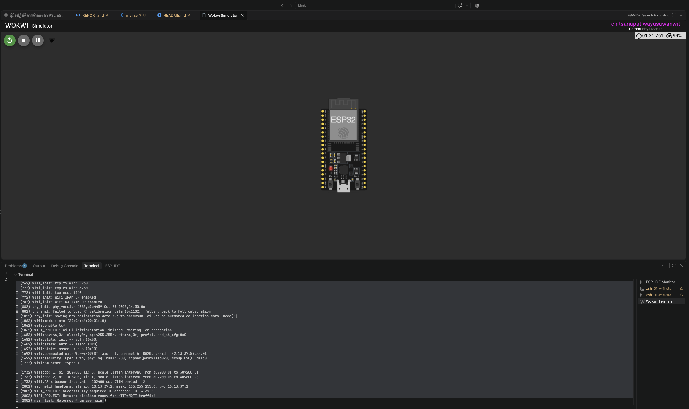
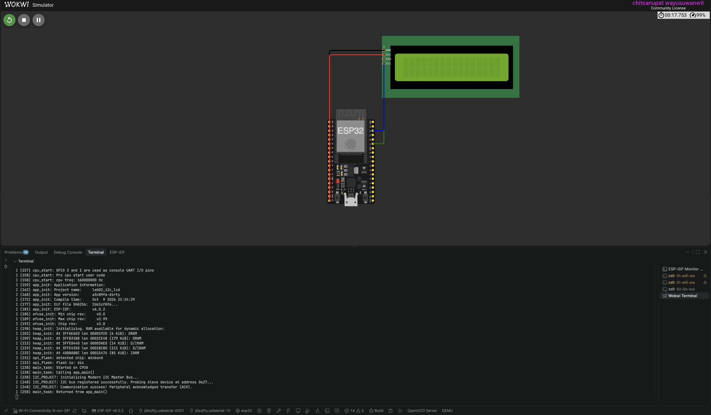
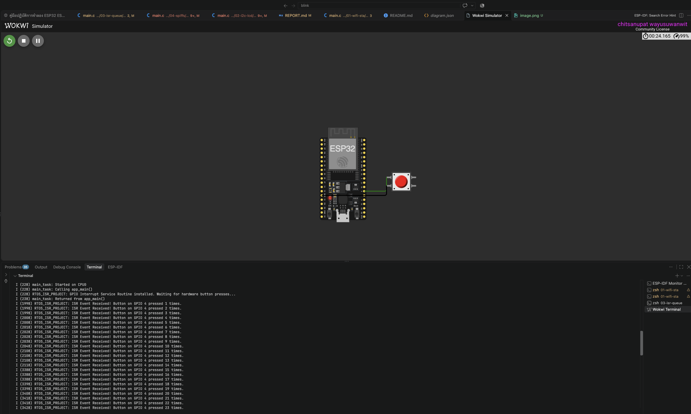

# รายงานผลการทดลอง: การจำลอง ESP32 ด้วย ESP-IDF และ FreeRTOS บน Wokwi

> งานทดแทนการเข้าเรียนวันที่ 9 ต.ค. 2569 (5 คะแนน)
> คู่มือการทดลอง: [docs/lab-manual-th.html](docs/lab-manual-th.html) (ฉบับภาษาอังกฤษ: [docs/lab-manual-en.html](docs/lab-manual-en.html))

| หัวข้อ | รายละเอียด |
| --- | --- |
| ชื่อ-นามสกุล | ชิษณุพัศก์ วายุสุวรณวิทย์ |
| รหัสนักศึกษา | 68030063 |
| รายวิชา | 03376126 Applied Microcontroller |
| ผู้สอน | Piya Jitthammapirom |
| วันที่ทำการทดลอง | 9/10/26    |
| Branch | `Wi-Fi-Connectivity-9-oct-26` |

---

## 0. สภาพแวดล้อมการทดลอง

| รายการ | เวอร์ชัน / รายละเอียด |
| --- | --- |
| บอร์ด (จำลอง) | ESP32 DevKitC V4 (`board-esp32-devkit-c-v4`) |
| ESP-IDF | v6.0.2 |
| VS Code Extension | Espressif IDF, Wokwi Simulator |
| ระบบปฏิบัติการ | macOS |

**วิธี build และรันแต่ละแลป** (ทำใน ESP-IDF Terminal หรือ `source ~/.espressif/tools/activate_idf_v6.0.2.sh` ก่อน):

```bash
cd labs-9-oct-26/01-wifi-sta        # เปลี่ยนเป็นโฟลเดอร์ของแลปที่ต้องการ
idf.py set-target esp32
idf.py build
```

จากนั้นใน VS Code: `F1` → `Wokwi: Select Config File` → เลือก `labs-9-oct-26/<แลป>/wokwi.toml` → `Wokwi: Start Simulator`

---

## 1. โมดูลที่ 1: การเชื่อมต่อ Wi-Fi ผ่าน Wokwi-GUEST (STA)

**โค้ด:** [labs-9-oct-26/01-wifi-sta/main/main.c](labs-9-oct-26/01-wifi-sta/main/main.c) · **วงจร:** [labs-9-oct-26/01-wifi-sta/diagram.json](labs-9-oct-26/01-wifi-sta/diagram.json)

### 1.1 วัตถุประสงค์
เข้าใจลำดับการเริ่มต้น Wi-Fi ของ ESP32 ในโหมด Station: NVS, `esp_netif`, default event loop, event callback และ FreeRTOS Event Group

### 1.2 หลักการทำงาน / สิ่งที่เรียนรู้
ESP32 ทำตัวเหมือนมือถือที่ไปต่อ Wi-Fi ชื่อ `Wokwi-GUEST` (router จำลองของ Wokwi) ไม่ได้เป็น router เอง

- เริ่มจากเปิด NVS ก่อน เพราะ Wi-Fi ต้องใช้เก็บค่าปรับจูนวิทยุ
- สั่งเริ่ม Wi-Fi แล้วโปรแกรมไม่ได้รอให้ต่อติดทันที แต่ไดรเวอร์จะแจ้งกลับมาเป็น "อีเวนต์" เช่น เริ่มแล้ว / ต่อติดแล้ว / ได้ IP แล้ว ผ่านฟังก์ชัน `event_handler`
- `app_main` ใช้ Event Group เป็นเหมือนธงสัญญาณ ยืนรอจนกว่า `event_handler` จะยกธงตอนได้ IP แล้วค่อยทำงานต่อ
- router จะแจก IP ให้อัตโนมัติผ่าน DHCP

### 1.3 ขั้นตอนการทดลอง
1. เริ่มต้นหน่วยความจำ NVS ด้วย `nvs_flash_init()`
2. เริ่มต้นสแต็กเครือข่ายด้วย `esp_netif_init()` และสร้าง event loop ด้วย `esp_event_loop_create_default()`
3. สร้างอินเทอร์เฟซ Wi-Fi โหมด Station ด้วย `esp_netif_create_default_wifi_sta()` แล้วเริ่มไดรเวอร์ด้วย `esp_wifi_init()`
4. ลงทะเบียนฟังก์ชัน `event_handler` ให้รับอีเวนต์ `WIFI_EVENT` และ `IP_EVENT`
5. ตั้งค่า SSID เป็น `Wokwi-GUEST` (ไม่มีรหัสผ่าน) แล้วเรียก `esp_wifi_start()`
6. ใช้ `xEventGroupWaitBits()` ให้ `app_main` รอจนกว่าจะได้รับ IP
7. `cd labs-9-oct-26/01-wifi-sta` แล้ว `idf.py set-target esp32` และ `idf.py build`
8. เลือก `Wokwi: Select Config File` → `01-wifi-sta/wokwi.toml` แล้ว `Wokwi: Start Simulator` ดูผลใน Serial Monitor


### 1.4 ผลการทดลอง



```text
rst:0x1 (POWERON_RESET),boot:0x13 (SPI_FAST_FLASH_BOOT)
configsip: 0, SPIWP:0xee
clk_drv:0x00,q_drv:0x00,d_drv:0x00,cs0_drv:0x00,hd_drv:0x00,wp_drv:0x00
mode:DIO, clock div:2
load:0x3fff0040,len:6272
load:0x40078000,len:15820
load:0x40080400,len:3920
entry 0x40080644
I (12) boot: ESP-IDF v6.0.2 2nd stage bootloader
I (13) boot: compile time Oct  9 2026 20:22:39
I (13) boot: Multicore bootloader
I (14) boot: chip revision: v3.0
I (16) boot.esp32: SPI Speed      : 40MHz
I (19) boot.esp32: SPI Mode       : DIO
I (23) boot.esp32: SPI Flash Size : 2MB
I (27) boot: Enabling RNG early entropy source...
I (31) boot: Partition Table:
I (34) boot: ## Label            Usage          Type ST Offset   Length
I (40) boot:  0 nvs              WiFi data        01 02 00009000 00006000
I (46) boot:  1 phy_init         RF data          01 01 0000f000 00001000
I (53) boot:  2 factory          factory app      00 00 00010000 00177000
I (60) boot: End of partition table
I (63) esp_image: segment 0: paddr=00010020 vaddr=3f400020 size=19178h (102776) map
I (205) esp_image: segment 1: paddr=000291a0 vaddr=3ffb0000 size=04528h ( 17704) load
I (233) esp_image: segment 2: paddr=0002d6d0 vaddr=40080000 size=02948h ( 10568) load
I (251) esp_image: segment 3: paddr=00030020 vaddr=400d0020 size=85c8ch (547980) map
I (968) esp_image: segment 4: paddr=000b5cb4 vaddr=40082948 size=12cc0h ( 76992) load
I (1088) esp_image: segment 5: paddr=000c897c vaddr=50000000 size=00028h (    40) load
I (1124) boot: Loaded app from partition at offset 0x10000
I (1125) boot: Disabling RNG early entropy source...
I (1138) cpu_start: Multicore app
I (570) cpu_start: GPIO 3 and 1 are used as console UART I/O pins
I (571) cpu_start: Pro cpu start user code
I (571) cpu_start: cpu freq: 160000000 Hz
I (573) app_init: Application information:
I (576) app_init: Project name:     lab01_wifi_sta
I (581) app_init: App version:      8b64195-dirty
I (585) app_init: Compile time:     Oct  9 2026 20:22:36
I (590) app_init: ELF file SHA256:  4ac7a2a15...
I (595) app_init: ESP-IDF:          v6.0.2
I (598) efuse_init: Min chip rev:     v0.0
I (602) efuse_init: Max chip rev:     v3.99 
I (606) efuse_init: Chip rev:         v3.0
I (611) heap_init: Initializing. RAM available for dynamic allocation:
I (616) heap_init: At 3FFAE6E0 len 00001920 (6 KiB): DRAM
I (622) heap_init: At 3FFB8A40 len 000275C0 (157 KiB): DRAM
I (627) heap_init: At 3FFE0440 len 00003AE0 (14 KiB): D/IRAM
I (632) heap_init: At 3FFE4350 len 0001BCB0 (111 KiB): D/IRAM
I (638) heap_init: At 40095608 len 0000A9F8 (42 KiB): IRAM
I (644) spi_flash: detected chip: winbond
I (647) spi_flash: flash io: dio
I (652) main_task: Started on CPU0
I (652) main_task: Calling app_main()
I (702) wifi:wifi driver task: 3ffc0264, prio:23, stack:6656, core=0
I (712) wifi:wifi firmware version: 00ad238
I (722) wifi:wifi certification version: v7.0
I (722) wifi:config NVS flash: enabled
I (722) wifi:config nano formatting: disabled
I (722) wifi:Init data frame dynamic rx buffer num: 32
I (722) wifi:Init static rx mgmt buffer num: 5
I (732) wifi:Init management short buffer num: 32
I (732) wifi:Init dynamic tx buffer num: 32
I (742) wifi:Init static rx buffer size: 1600
I (742) wifi:Init static rx buffer num: 10
I (742) wifi:Init dynamic rx buffer num: 32
I (752) wifi_init: rx ba win: 6
I (752) wifi_init: accept mbox: 6
I (752) wifi_init: tcpip mbox: 32
I (762) wifi_init: udp mbox: 6
I (762) wifi_init: tcp mbox: 6
I (762) wifi_init: tcp tx win: 5760
I (772) wifi_init: tcp rx win: 5760
I (772) wifi_init: tcp mss: 1440
I (772) wifi_init: WiFi IRAM OP enabled
I (782) wifi_init: WiFi RX IRAM OP enabled
I (882) phy_init: phy_version 4863,a3a4459,Oct 28 2025,14:30:06
W (882) phy_init: failed to load RF calibration data (0x1102), falling back to full calibration
I (1022) phy_init: Saving new calibration data due to checksum failure or outdated calibration data, mode(2)
I (1062) wifi:mode : sta (24:0a:c4:00:01:10)
I (1062) wifi:enable tsf
I (1062) WIFI_PROJECT: Wi-Fi initialization finished. Waiting for connection...
I (1682) wifi:new:<6,0>, old:<1,0>, ap:<255,255>, sta:<6,0>, prof:1, snd_ch_cfg:0x0
I (1682) wifi:state: init -> auth (0xb0)
I (1682) wifi:state: auth -> assoc (0x0)
I (1692) wifi:state: assoc -> run (0x10)
I (1692) wifi:connected with Wokwi-GUEST, aid = 1, channel 6, BW20, bssid = 42:13:37:55:aa:01
I (1692) wifi:security: Open Auth, phy: bg, rssi: -80, cipher(pairwise:0x0, group:0x0), pmf:0
I (1722) wifi:pm start, type: 1

I (1732) wifi:dp: 1, bi: 102400, li: 3, scale listen interval from 307200 us to 307200 us
I (1732) wifi:dp: 2, bi: 102400, li: 4, scale listen interval from 307200 us to 409600 us
I (1732) wifi:AP's beacon interval = 102400 us, DTIM period = 2
I (2802) esp_netif_handlers: sta ip: 10.13.37.2, mask: 255.255.255.0, gw: 10.13.37.1
I (2802) WIFI_PROJECT: Successfully acquired IP address: 10.13.37.2
I (2802) WIFI_PROJECT: Network pipeline ready for HTTP/MQTT traffic!
I (2802) main_task: Returned from app_main()
```

### 1.5 ตรวจสอบตนเอง

| หัวข้อการประเมิน | ผลลัพธ์ที่ต้องตรวจสอบ | ผล |
| --- | --- | --- |
| การเริ่มต้น NVS | `nvs_flash_init()` คืนค่า `ESP_OK` | ☑ ผ่าน ☐ ไม่ผ่าน |
| การเชื่อมต่อ SSID | เชื่อมต่อ `Wokwi-GUEST` สำเร็จ | ☑ ผ่าน ☐ ไม่ผ่าน |
| การได้รับ IP จาก DHCP | ได้ IPv4 ผ่าน `IP_EVENT_STA_GOT_IP` | ☑ ผ่าน ☐ ไม่ผ่าน |
| การซิงโครไนซ์อีเวนต์ | Event Group ปลดบล็อก `app_main` | ☑ ผ่าน ☐ ไม่ผ่าน |

### 1.6 วิเคราะห์ผล
- ได้ IP `10.13.37.2`, gateway `10.13.37.1`, subnet `255.255.255.0`
- ต่อ router ติดใช้เวลาประมาณ 0.6 วินาที (1062 → 1692 ms) และได้ IP ประมาณ 1.7 วินาทีหลังเริ่ม Wi-Fi (→ 2802 ms)
- ไม่มีบรรทัด `Retrying Wi-Fi connection...` เลย แปลว่าต่อติดตั้งแต่ครั้งแรก เพราะ `Wokwi-GUEST` ไม่มีรหัสผ่าน
- มีบรรทัด `failed to load RF calibration data` เพราะรันครั้งแรกยังไม่มีค่าปรับจูนเก็บไว้ ระบบเลยปรับจูนใหม่แล้วบันทึกลง NVS ให้เอง (เห็นชัดว่าทำไมต้องเปิด NVS ก่อน)

---

## 2. โมดูลที่ 2: ไดรเวอร์ I2C Master และจอ LCD

**โค้ด:** [labs-9-oct-26/02-i2c-lcd/main/main.c](labs-9-oct-26/02-i2c-lcd/main/main.c) · **วงจร:** [labs-9-oct-26/02-i2c-lcd/diagram.json](labs-9-oct-26/02-i2c-lcd/diagram.json)

### 2.1 วัตถุประสงค์
ใช้ API `driver/i2c_master.h` ของ ESP-IDF สร้างบัส I2C และสื่อสารกับ LCD1602 ผ่านโมดูล PCF8574 ที่ที่อยู่ `0x27`

### 2.2 การต่อวงจร

| ขา ESP32 | ขา LCD | หน้าที่ |
| --- | --- | --- |
| GPIO 21 | SDA | สายข้อมูล I2C |
| GPIO 22 | SCL | สายสัญญาณนาฬิกา I2C (100 kHz) |
| 5V | VCC | ไฟเลี้ยง +5V |
| GND | GND | กราวด์ร่วม |

### 2.3 หลักการทำงาน / สิ่งที่เรียนรู้
- I2C ใช้สายแค่ 2 เส้น (SDA ข้อมูล, SCL นาฬิกา) ต่ออุปกรณ์หลายตัวบนสายเดียวกันได้ แยกกันด้วย "ที่อยู่" (จอนี้คือ `0x27`)
- **bus handle** = ตัวแทนของสาย I2C ทั้งเส้น (ขาไหน, พอร์ตไหน) ส่วน **device handle** = ตัวแทนของอุปกรณ์แต่ละตัวบนสายนั้น (ที่อยู่ + ความเร็ว)
- ต้องมี pull-up เพราะขา I2C ดึงสัญญาณลง LOW ได้อย่างเดียว ต้องมีตัวต้านทานดึงกลับขึ้น HIGH เอง
- ตอนส่งข้อมูล ถ้ามีอุปกรณ์อยู่ที่ที่อยู่นั้นจริง มันจะตอบกลับ ACK (เหมือนเคาะประตูแล้วมีคนขานรับ)

### 2.4 ขั้นตอนการทดลอง
1. ต่อจอ LCD1602 แบบ I2C ใน `diagram.json`: SDA → GPIO21, SCL → GPIO22, VCC → 5V, GND → GND
2. ตั้งค่าบัส I2C (GPIO21/22, เปิด pull-up ภายใน) แล้วสร้างบัสด้วย `i2c_new_master_bus()`
3. เพิ่มอุปกรณ์ที่อยู่ `0x27` ความเร็ว 100 kHz ด้วย `i2c_master_bus_add_device()`
4. ส่งข้อมูล 1 ไบต์ (`0x08`) ด้วย `i2c_master_transmit()` แล้วดูว่าได้ ACK ไหม
5. build และรันใน Wokwi แล้วดูผลใน Serial Monitor

### 2.5 ผลการทดลอง



```text
ets Jul 29 2019 12:21:46

rst:0x1 (POWERON_RESET),boot:0x13 (SPI_FAST_FLASH_BOOT)
configsip: 0, SPIWP:0xee
clk_drv:0x00,q_drv:0x00,d_drv:0x00,cs0_drv:0x00,hd_drv:0x00,wp_drv:0x00
mode:DIO, clock div:2
load:0x3fff0040,len:6272
load:0x40078000,len:15820
load:0x40080400,len:3920
entry 0x40080644
I (12) boot: ESP-IDF v6.0.2 2nd stage bootloader
I (13) boot: compile time Oct  9 2026 21:34:32
I (13) boot: Multicore bootloader
I (14) boot: chip revision: v3.0
I (16) boot.esp32: SPI Speed      : 40MHz
I (19) boot.esp32: SPI Mode       : DIO
I (23) boot.esp32: SPI Flash Size : 2MB
I (27) boot: Enabling RNG early entropy source...
I (31) boot: Partition Table:
I (34) boot: ## Label            Usage          Type ST Offset   Length
I (40) boot:  0 nvs              WiFi data        01 02 00009000 00006000
I (46) boot:  1 phy_init         RF data          01 01 0000f000 00001000
I (53) boot:  2 factory          factory app      00 00 00010000 00100000
I (60) boot: End of partition table
I (63) esp_image: segment 0: paddr=00010020 vaddr=3f400020 size=081a4h ( 33188) map
I (114) esp_image: segment 1: paddr=000181cc vaddr=3ffb0000 size=02820h ( 10272) load
I (131) esp_image: segment 2: paddr=0001a9f4 vaddr=40080000 size=05624h ( 22052) load
I (167) esp_image: segment 3: paddr=00020020 vaddr=400d0020 size=0e314h ( 58132) map
I (244) esp_image: segment 4: paddr=0002e33c vaddr=40085624 size=05568h ( 21864) load
I (279) esp_image: segment 5: paddr=000338ac vaddr=50000000 size=00028h (    40) load
I (299) boot: Loaded app from partition at offset 0x10000
I (299) boot: Disabling RNG early entropy source...
I (311) cpu_start: Multicore app
I (157) cpu_start: GPIO 3 and 1 are used as console UART I/O pins
I (158) cpu_start: Pro cpu start user code
I (158) cpu_start: cpu freq: 160000000 Hz
I (159) app_init: Application information:
I (163) app_init: Project name:     lab02_i2c_lcd
I (168) app_init: App version:      a3c89fa-dirty
I (172) app_init: Compile time:     Oct  9 2026 21:34:29
I (177) app_init: ELF file SHA256:  2de1cf0f6...
I (181) app_init: ESP-IDF:          v6.0.2
I (185) efuse_init: Min chip rev:     v0.0
I (189) efuse_init: Max chip rev:     v3.99 
I (193) efuse_init: Chip rev:         v3.0
I (198) heap_init: Initializing. RAM available for dynamic allocation:
I (203) heap_init: At 3FFAE6E0 len 00001920 (6 KiB): DRAM
I (209) heap_init: At 3FFB31B8 len 0002CE48 (179 KiB): DRAM
I (213) heap_init: At 3FFE0440 len 00003AE0 (14 KiB): D/IRAM
I (219) heap_init: At 3FFE4350 len 0001BCB0 (111 KiB): D/IRAM
I (225) heap_init: At 4008AB8C len 00015474 (85 KiB): IRAM
I (231) spi_flash: detected chip: winbond
I (233) spi_flash: flash io: dio
I (238) main_task: Started on CPU0
I (238) main_task: Calling app_main()
I (238) I2C_PROJECT: Initializing Modern I2C Master Bus...
I (248) I2C_PROJECT: I2C bus registered successfully. Probing slave device at address 0x27...
I (248) I2C_PROJECT: Communication success! Peripheral acknowledged transfer (ACK).
I (258) main_task: Returned from app_main()

```

### 2.6 ตรวจสอบตนเอง

| หัวข้อการประเมิน | ผลลัพธ์ที่ต้องตรวจสอบ | ผล |
| --- | --- | --- |
| การเริ่มต้น I2C Master | `i2c_new_master_bus()` คืนค่า `ESP_OK` | ☑ ผ่าน ☐ ไม่ผ่าน |
| การลงทะเบียนอุปกรณ์ Slave | ผูกกับที่อยู่ `0x27` ที่ 100 kHz | ☑ ผ่าน ☐ ไม่ผ่าน |
| การตอบกลับ ACK | `i2c_master_transmit()` ไม่ timeout | ☑ ผ่าน ☐ ไม่ผ่าน |

### 2.7 วิเคราะห์ผล
- ได้ ACK ขึ้น `Communication success!` แปลว่า ESP32 คุยกับจอที่ที่อยู่ `0x27` ได้จริง
- จอ LCD **ไม่ขึ้นตัวหนังสือ** ซึ่งถูกต้อง เพราะโค้ดส่งแค่ `0x08` = สั่งเปิดไฟพื้นหลังอย่างเดียว ยังไม่ได้สั่งเริ่มต้นจอหรือส่งตัวอักษร แลปนี้ทดสอบแค่ว่าอุปกรณ์ตอบรับหรือไม่
- ถ้าเปลี่ยนที่อยู่เป็นค่าที่ไม่มีอุปกรณ์ จะไม่มีใครตอบ ACK และโปรแกรมจะไปเข้าเงื่อนไข `Communication failed`

---

## 3. โมดูลที่ 3: อินเทอร์รัปต์แบบเลื่อนเวลา (ISR + Queue)

**โค้ด:** [labs-9-oct-26/03-isr-queue/main/main.c](labs-9-oct-26/03-isr-queue/main/main.c) · **วงจร:** [labs-9-oct-26/03-isr-queue/diagram.json](labs-9-oct-26/03-isr-queue/diagram.json)

### 3.1 วัตถุประสงค์
ใช้อินเทอร์รัปต์ GPIO แบบขอบขาลง (falling edge) ร่วมกับ `IRAM_ATTR` และส่งเหตุการณ์ไปยัง worker task ผ่าน FreeRTOS Queue แทนการ polling

### 3.2 การต่อวงจร
ปุ่มกด ขาหนึ่งต่อ GPIO 4 (เปิด pull-up ภายใน) อีกขาต่อ GND → กดปุ่มแล้วสัญญาณเปลี่ยนจาก HIGH เป็น LOW

### 3.3 หลักการทำงาน / สิ่งที่เรียนรู้
เส้นทางข้อมูล: **กดปุ่ม → ISR → Queue → Task**

- แทนที่จะวนเช็กปุ่มตลอดเวลา (polling) ให้ฮาร์ดแวร์เรียก ISR เองตอนสัญญาณตกจาก HIGH เป็น LOW (ตอนกดปุ่ม)
- ISR ทำงานสั้นที่สุด แค่โยนหมายเลขขาใส่ Queue แล้วจบ (ใส่ `IRAM_ATTR` ให้โค้ดอยู่ใน RAM เรียกได้เร็วและปลอดภัย)
- Task เบื้องหลังนอนรอที่ Queue พอมีของเข้ามาก็ตื่นมานับและพิมพ์ log
- ที่ไม่ทำงานหนักใน ISR เพราะระหว่างอยู่ใน ISR งานอื่นต้องหยุดรอ ถ้าช้าไประบบจะค้างหรือพังได้

### 3.4 ขั้นตอนการทดลอง
1. ต่อปุ่มใน `diagram.json`: ขาหนึ่ง → GPIO4 อีกขา → GND
2. เขียน ISR `gpio_isr_handler` (มี `IRAM_ATTR`) ที่เรียก `xQueueSendFromISR()`
3. เขียน `button_worker_task` รอ `xQueueReceive()` แล้วนับจำนวนครั้งที่กด
4. สร้าง Queue (ขนาด 10) และ Task ใน `app_main`
5. ตั้ง GPIO4 เป็น input เปิด pull-up และให้เกิด interrupt ตอนขอบขาลง แล้วติดตั้ง ISR
6. build รันใน Wokwi แล้วกดปุ่มสีแดง ดูผลใน Serial Monitor

### 3.5 ผลการทดลอง



```text
I (228) main_task: Started on CPU0
I (228) main_task: Calling app_main()
I (228) RTOS_ISR_PROJECT: GPIO Interrupt Service Routine installed. Waiting for hardware button presses...
I (238) main_task: Returned from app_main()
I (1998) RTOS_ISR_PROJECT: ISR Event Received! Button on GPIO 4 pressed 1 times.
I (1998) RTOS_ISR_PROJECT: ISR Event Received! Button on GPIO 4 pressed 2 times.
I (1998) RTOS_ISR_PROJECT: ISR Event Received! Button on GPIO 4 pressed 3 times.
I (2008) RTOS_ISR_PROJECT: ISR Event Received! Button on GPIO 4 pressed 4 times.
I (2008) RTOS_ISR_PROJECT: ISR Event Received! Button on GPIO 4 pressed 5 times.
I (2018) RTOS_ISR_PROJECT: ISR Event Received! Button on GPIO 4 pressed 6 times.
I (2028) RTOS_ISR_PROJECT: ISR Event Received! Button on GPIO 4 pressed 7 times.
I (2028) RTOS_ISR_PROJECT: ISR Event Received! Button on GPIO 4 pressed 8 times.
I (2038) RTOS_ISR_PROJECT: ISR Event Received! Button on GPIO 4 pressed 9 times.
I (2048) RTOS_ISR_PROJECT: ISR Event Received! Button on GPIO 4 pressed 10 times.
I (2108) RTOS_ISR_PROJECT: ISR Event Received! Button on GPIO 4 pressed 11 times.
I (2108) RTOS_ISR_PROJECT: ISR Event Received! Button on GPIO 4 pressed 12 times.
I (2108) RTOS_ISR_PROJECT: ISR Event Received! Button on GPIO 4 pressed 13 times.
I (2118) RTOS_ISR_PROJECT: ISR Event Received! Button on GPIO 4 pressed 14 times.
I (3388) RTOS_ISR_PROJECT: ISR Event Received! Button on GPIO 4 pressed 15 times.
I (3388) RTOS_ISR_PROJECT: ISR Event Received! Button on GPIO 4 pressed 16 times.
I (3388) RTOS_ISR_PROJECT: ISR Event Received! Button on GPIO 4 pressed 17 times.
I (3398) RTOS_ISR_PROJECT: ISR Event Received! Button on GPIO 4 pressed 18 times.
I (3398) RTOS_ISR_PROJECT: ISR Event Received! Button on GPIO 4 pressed 19 times.
I (3408) RTOS_ISR_PROJECT: ISR Event Received! Button on GPIO 4 pressed 20 times.
I (3418) RTOS_ISR_PROJECT: ISR Event Received! Button on GPIO 4 pressed 21 times.
I (3418) RTOS_ISR_PROJECT: ISR Event Received! Button on GPIO 4 pressed 22 times.
I (3428) RTOS_ISR_PROJECT: ISR Event Received! Button on GPIO 4 pressed 23 times.
I (3438) RTOS_ISR_PROJECT: ISR Event Received! Button on GPIO 4 pressed 24 times.
I (3448) RTOS_ISR_PROJECT: ISR Event Received! Button on GPIO 4 pressed 25 times.
I (3448) RTOS_ISR_PROJECT: ISR Event Received! Button on GPIO 4 pressed 26 times.
I (3458) RTOS_ISR_PROJECT: ISR Event Received! Button on GPIO 4 pressed 27 times.
I (3468) RTOS_ISR_PROJECT: ISR Event Received! Button on GPIO 4 pressed 28 times.
I (3478) RTOS_ISR_PROJECT: ISR Event Received! Button on GPIO 4 pressed 29 times.
I (3478) RTOS_ISR_PROJECT: ISR Event Received! Button on GPIO 4 pressed 30 times.
I (3488) RTOS_ISR_PROJECT: ISR Event Received! Button on GPIO 4 pressed 31 times.
I (3498) RTOS_ISR_PROJECT: ISR Event Received! Button on GPIO 4 pressed 32 times.
I (3498) RTOS_ISR_PROJECT: ISR Event Received! Button on GPIO 4 pressed 33 times.
I (3508) RTOS_ISR_PROJECT: ISR Event Received! Button on GPIO 4 pressed 34 times.
I (9728) RTOS_ISR_PROJECT: ISR Event Received! Button on GPIO 4 pressed 35 times.
I (9728) RTOS_ISR_PROJECT: ISR Event Received! Button on GPIO 4 pressed 36 times.
I (9728) RTOS_ISR_PROJECT: ISR Event Received! Button on GPIO 4 pressed 37 times.
```

### 3.6 ตรวจสอบตนเอง

| หัวข้อการประเมิน | ผลลัพธ์ที่ต้องตรวจสอบ | ผล |
| --- | --- | --- |
| ตำแหน่งการทำงานของ ISR | handler ระบุ `IRAM_ATTR` | ☑ ผ่าน ☐ ไม่ผ่าน |
| การส่งต่องานผ่านคิว | `xQueueSendFromISR()` ทำงานโดยไม่แครช | ☑ ผ่าน ☐ ไม่ผ่าน |
| การปลดบล็อก Task | worker task ได้รับข้อความแบบอะซิงโครนัส | ☑ ผ่าน ☐ ไม่ผ่าน |

### 3.7 วิเคราะห์ผล
- ระบบทำงานได้ กดปุ่มแล้ว Task ได้รับข้อความและพิมพ์ log จริง โปรแกรมไม่ค้าง
- แต่ **กด 1 ครั้งนับได้หลายครั้ง** ดูจาก log จะเห็นเป็น 3 ช่วงเวลา (~2.0 s, ~3.4 s, ~9.7 s) ช่วงละหลายครั้งติดกันภายในไม่กี่สิบ ms
- สาเหตุคือ **ปุ่มเด้ง (bounce)** หน้าสัมผัสปุ่มกระทบไปมาตอนกด ทำให้เกิดขอบขาลงหลายรอบ Wokwi จำลองอาการนี้เหมือนปุ่มจริง
- แก้ได้โดยทำ debounce เช่น ไม่นับซ้ำถ้าห่างจากครั้งก่อนไม่ถึง ~50 ms

---

## 4. โมดูลที่ 4: ระบบไฟล์บนแฟลช (SPIFFS / VFS)

**โค้ด:** [labs-9-oct-26/04-spiffs/main/main.c](labs-9-oct-26/04-spiffs/main/main.c) · **ตารางพาร์ทิชัน:** [labs-9-oct-26/04-spiffs/partitions.csv](labs-9-oct-26/04-spiffs/partitions.csv)

### 4.1 วัตถุประสงค์
สร้างพาร์ทิชัน SPIFFS เมานต์ผ่าน VFS แล้วเขียน/อ่านไฟล์ด้วยคำสั่ง POSIX (`fopen`, `fprintf`, `fgets`, `fclose`)

### 4.2 ตารางพาร์ทิชัน

| Name | Type | SubType | Offset | Size |
| --- | --- | --- | --- | --- |
| nvs | data | nvs | 0x9000 | 0x6000 |
| phy_init | data | phy | 0xf000 | 0x1000 |
| factory | app | factory | 0x10000 | 1M |
| storage | data | spiffs | (อัตโนมัติ) | 0x100000 |

### 4.3 หลักการทำงาน / สิ่งที่เรียนรู้
- แบ่งแฟลชส่วนหนึ่ง (`storage` 1 MB) ไว้เก็บไฟล์ ข้อมูลไม่หายแม้ปิดไฟ
- **SPIFFS** คือระบบไฟล์ที่จัดการเก็บไฟล์ลงแฟลช
- **VFS** เป็นตัวกลาง พอ mount ที่ `/spiffs` แล้ว เราใช้ `fopen`/`fprintf`/`fgets` แบบภาษา C ปกติได้เลย VFS จะส่งต่อให้ SPIFFS ไปเขียนแฟลชเอง
- **wear-leveling** คือการกระจายการเขียนไปหลายตำแหน่ง ไม่เขียนซ้ำที่เดิม เพราะแฟลชเขียนซ้ำได้จำนวนครั้งจำกัด ช่วยให้แฟลชอายุยืนขึ้น

### 4.4 ขั้นตอนการทดลอง
1. สร้าง `partitions.csv` เพิ่มพาร์ทิชัน `storage` ชนิด spiffs ขนาด 1 MB
2. ตั้ง `sdkconfig.defaults` ให้ใช้ตารางพาร์ทิชันนี้ และตั้งแฟลชเป็น 4 MB
3. mount SPIFFS ที่ `/spiffs` ด้วย `esp_vfs_spiffs_register()` (ตั้งให้ format อัตโนมัติถ้า mount ไม่ได้)
4. เขียนข้อความลงไฟล์ `/spiffs/log.txt` แล้วปิดไฟล์
5. เปิดไฟล์อ่านกลับมา พิมพ์ออก Serial Monitor แล้ว unmount
6. build รันใน Wokwi ดูผล

### 4.5 ผลการทดลอง


```text
entry 0x40080644
I (12) boot: ESP-IDF v6.0.2 2nd stage bootloader
I (13) boot: compile time Oct  9 2026 22:34:59
I (13) boot: Multicore bootloader
I (14) boot: chip revision: v3.0
I (16) boot.esp32: SPI Speed      : 40MHz
I (19) boot.esp32: SPI Mode       : DIO
I (23) boot.esp32: SPI Flash Size : 4MB
I (27) boot: Enabling RNG early entropy source...
I (31) boot: Partition Table:
I (34) boot: ## Label            Usage          Type ST Offset   Length
I (40) boot:  0 nvs              WiFi data        01 02 00009000 00006000
I (46) boot:  1 phy_init         RF data          01 01 0000f000 00001000
I (53) boot:  2 factory          factory app      00 00 00010000 00100000
I (59) boot:  3 storage          Unknown data     01 82 00110000 00100000
I (66) boot: End of partition table
I (70) esp_image: segment 0: paddr=00010020 vaddr=3f400020 size=078cch ( 30924) map
I (118) esp_image: segment 1: paddr=000178f4 vaddr=3ffb0000 size=02acch ( 10956) load
I (136) esp_image: segment 2: paddr=0001a3c8 vaddr=40080000 size=05c50h ( 23632) load
I (174) esp_image: segment 3: paddr=00020020 vaddr=400d0020 size=11f1ch ( 73500) map
I (271) esp_image: segment 4: paddr=00031f44 vaddr=40085c50 size=05788h ( 22408) load
I (307) esp_image: segment 5: paddr=000376d4 vaddr=50000000 size=00028h (    40) load
I (327) boot: Loaded app from partition at offset 0x10000
I (328) boot: Disabling RNG early entropy source...
I (340) cpu_start: Multicore app
I (172) cpu_start: GPIO 3 and 1 are used as console UART I/O pins
I (172) cpu_start: Pro cpu start user code
I (173) cpu_start: cpu freq: 160000000 Hz
I (174) app_init: Application information:
I (178) app_init: Project name:     lab04_spiffs
I (182) app_init: App version:      a3c89fa-dirty
I (186) app_init: Compile time:     Oct  9 2026 22:33:36
I (191) app_init: ELF file SHA256:  4fc585811...
I (196) app_init: ESP-IDF:          v6.0.2
I (199) efuse_init: Min chip rev:     v0.0
I (203) efuse_init: Max chip rev:     v3.99 
I (207) efuse_init: Chip rev:         v3.0
I (212) heap_init: Initializing. RAM available for dynamic allocation:
I (217) heap_init: At 3FFAE6E0 len 00001920 (6 KiB): DRAM
I (223) heap_init: At 3FFB3478 len 0002CB88 (178 KiB): DRAM
I (228) heap_init: At 3FFE0440 len 00003AE0 (14 KiB): D/IRAM
I (233) heap_init: At 3FFE4350 len 0001BCB0 (111 KiB): D/IRAM
I (239) heap_init: At 4008B3D8 len 00014C28 (83 KiB): IRAM
I (245) spi_flash: detected chip: gd
I (247) spi_flash: flash io: dio
I (252) main_task: Started on CPU0
I (252) main_task: Calling app_main()
I (252) STORAGE_PROJECT: Initializing SPIFFS Virtual File System...
W (262) SPIFFS: mount failed, -10025. formatting...
I (4312) STORAGE_PROJECT: SPIFFS mounted successfully at /spiffs. Executing POSIX Write Operation...
I (4532) STORAGE_PROJECT: File successfully written and flushed to flash.
I (4532) STORAGE_PROJECT: Read back string from SPIFFS: Sensor Log Entry #104: Temp=24.5C, Humidity=60%
I (4532) STORAGE_PROJECT: SPIFFS filesystem unmounted cleanly.
I (4542) main_task: Returned from app_main()
```

### 4.6 ตรวจสอบตนเอง

| หัวข้อการประเมิน | ผลลัพธ์ที่ต้องตรวจสอบ | ผล |
| --- | --- | --- |
| การลงทะเบียนพาร์ทิชัน | `esp_vfs_spiffs_register()` คืนค่า `ESP_OK` | ☑ ผ่าน ☐ ไม่ผ่าน |
| การเขียนไฟล์ด้วย POSIX | `fopen()`/`fprintf()` บันทึกลงแฟลชได้ | ☑ ผ่าน ☐ ไม่ผ่าน |
| ความถูกต้องของข้อมูล | ข้อมูลที่อ่านกลับตรงกับที่เขียนทุกตัวอักษร | ☑ ผ่าน ☐ ไม่ผ่าน |

### 4.7 วิเคราะห์ผล
- อ่านกลับได้ `Sensor Log Entry #104: Temp=24.5C, Humidity=60%` ตรงกับที่เขียนทุกตัวอักษร
- รันครั้งแรกขึ้น `mount failed, -10025. formatting...` เป็นเรื่องปกติ เพราะพาร์ทิชันยังว่างไม่เคยมีระบบไฟล์ โปรแกรมเลย format ให้อัตโนมัติ
- การ format ใช้เวลานานประมาณ 4 วินาที (262 → 4312 ms) ส่วนเขียนไฟล์ใช้แค่ ~0.2 วินาที
- log แสดงพาร์ทิชัน `storage` ที่ offset `0x110000` ขนาด 1 MB และแฟลช 4 MB ตามที่ตั้งไว้

---

## 5. การประเมินตนเองแบบรวม (Rubric)

| ด้านการเรียนรู้ | สมรรถนะทางเทคนิคหลัก | คะแนน (เต็ม 5) | หลักฐานจากการทดลอง |
| --- | --- | :---: | --- |
| 1. สแต็กโปรโตคอลเครือข่าย | `esp_netif`, Wi-Fi แบบ event-driven, DHCP | 5/5 | ต่อ `Wokwi-GUEST` ได้ครั้งแรก ได้ IP `10.13.37.2` (ข้อ 1.4) |
| 2. ไดรเวอร์บัสฮาร์ดแวร์ | `driver/i2c_master.h`, การสื่อสารกับ slave | 5/5 | ได้ ACK จากจอที่ `0x27` (ข้อ 2.5) |
| 3. รูปแบบการใช้ RTOS | ISR ใน IRAM + FreeRTOS Queue | 4/5 | ISR ส่งต่อให้ Task ผ่าน Queue ได้ แต่ยังไม่ได้แก้ปุ่มเด้ง (ข้อ 3.5, 3.7) |
| 4. ระบบจัดเก็บข้อมูลแบบฝังตัว | พาร์ทิชัน, VFS, POSIX file I/O | 5/5 | เขียน-อ่านไฟล์ได้ตรงกันทุกตัวอักษร (ข้อ 4.5) |

## 6. คำถามท้ายการทดลอง

1. **ทำไมต้องเริ่มต้น NVS flash ก่อนเริ่มสแต็ก Wi-Fi?**
   เพราะ Wi-Fi ใช้ NVS เป็นที่เก็บค่าปรับจูนวิทยุ (RF calibration) และค่าตั้งค่าต่างๆ ถ้าไม่เปิด NVS ก่อน Wi-Fi ก็อ่าน/บันทึกค่าพวกนี้ไม่ได้ ใน log ข้อ 1.4 จะเห็นว่ารอบแรกไม่มีค่าเก่า ระบบเลยปรับจูนใหม่แล้วบันทึกลง NVS
2. **สถาปัตยกรรมของ `driver/i2c.h` แบบเดิม ต่างจาก `driver/i2c_master.h` แบบใหม่อย่างไร?**
   แบบใหม่แยกเป็น "ตัวแทนสาย" (bus handle) กับ "ตัวแทนอุปกรณ์" (device handle) ชัดเจน ตั้งที่อยู่และความเร็วไว้ที่อุปกรณ์ครั้งเดียว เวลาส่งก็แค่ระบุอุปกรณ์ ใช้ง่ายและปลอดภัยกว่าเมื่อมีหลายอุปกรณ์หรือหลาย task ใช้สายเดียวกัน ส่วนแบบเก่าต้องระบุพอร์ตและที่อยู่เองทุกครั้ง
3. **ทำไมจึงห้ามเรียกคำสั่งที่บล็อก (เช่น `vTaskDelay`, `printf`) ภายใน ISR ที่ระบุ `IRAM_ATTR`?**
   เพราะตอนอยู่ใน ISR งานอื่นต้องหยุดรอ ถ้าไปรอหรือทำงานช้าใน ISR ระบบจะค้าง และ ISR ไม่ใช่ task จึง "นอนรอ" แบบ task ไม่ได้ อาจทำให้ระบบ crash ได้ ต้องทำให้สั้นที่สุดแล้วส่งงานต่อให้ task ด้วยฟังก์ชันที่ลงท้าย `FromISR`
4. **VFS แปลงคำสั่ง POSIX (`fopen`) ไปยังหน่วยความจำแฟลชได้อย่างไร?**
   VFS จำไว้ว่า path ที่ขึ้นต้นด้วย `/spiffs` เป็นของ SPIFFS พอเราเรียก `fopen("/spiffs/log.txt")` VFS ก็ส่งต่อไปให้ไดรเวอร์ SPIFFS ซึ่งจะไปอ่าน/เขียนแฟลชจริง (พร้อมกระจายการเขียนแบบ wear-leveling) ให้เอง

## 7. ปัญหาที่พบและวิธีแก้ไข

| ปัญหา | สาเหตุ | วิธีแก้ |
| --- | --- | --- |
| `zsh: command not found: idf.py` | terminal ปกติยังไม่ได้โหลด environment ของ ESP-IDF | รัน `source ~/.espressif/tools/activate_idf_v6.0.2.sh` หรือเปิด ESP-IDF Terminal |
| `diagram.json` ในคู่มือใช้ไม่ได้ | ชื่อบอร์ด/ขาผิด (`board-esp32-devkitc-v4`, `esp:P21`, `btn:1.1`) | แก้เป็น `board-esp32-devkit-c-v4`, `esp:21`, `btn:1.l` |
| พาร์ทิชันแลป 4 ไม่พอ | factory 1 MB + storage 1 MB เกินแฟลช 2 MB | ตั้ง `CONFIG_ESPTOOLPY_FLASHSIZE_4MB=y` |
| โค้ด SPIFFS ในคู่มือ compile ไม่ผ่าน | สตริงใน `fprintf` ถูกตัดขึ้นบรรทัดใหม่ | เขียนสตริงให้อยู่บรรทัดเดียว |
| SPIFFS ขึ้น `mount failed ... formatting` | รันครั้งแรกพาร์ทิชันยังว่าง | ปกติ ระบบ format ให้เอง (`format_if_mount_failed = true`) |
| กดปุ่ม 1 ครั้งนับหลายครั้ง | ปุ่มเด้ง (bounce) | ยังไม่ได้แก้ แก้ได้ด้วย debounce ~50 ms |
| จอ LCD ไม่ขึ้นตัวหนังสือ | โค้ดส่งแค่คำสั่งเปิดไฟพื้นหลัง | ไม่ใช่ปัญหา แลปทดสอบแค่ ACK |

## 8. สรุปผลการทดลอง
ทำครบทั้ง 4 แลปบน Wokwi และผ่านทุกข้อ

- **Wi-Fi:** ต่อ Wi-Fi ได้และได้ IP เข้าใจว่า Wi-Fi ทำงานแบบอีเวนต์ ต้องรอด้วย Event Group
- **I2C:** สร้างบัสและคุยกับจอที่ `0x27` ได้ ACK แต่การส่งไบต์เดียวยังไม่ทำให้จอแสดงผล
- **ISR + Queue:** ให้ปุ่มเรียก interrupt แล้วส่งงานต่อให้ task แทนการวนเช็ก และได้เจอปัญหาปุ่มเด้งของจริง
- **SPIFFS:** แบ่งแฟลชเก็บไฟล์ เขียน-อ่านด้วยคำสั่ง C ปกติได้ ข้อมูลตรงกัน

ได้รู้ด้วยว่าโค้ดและไฟล์วงจรจากคู่มือต้องเช็กและแก้ก่อนใช้จริง

## 9. เอกสารอ้างอิง
- [Wokwi ESP-IDF Hello Wi-Fi](https://github.com/wokwi/esp32-idf-hello-wifi)
- [ESP-IDF Wi-Fi Station Example](https://github.com/espressif/esp-idf/blob/master/examples/wifi/getting_started/station/main/station_example_main.c)
- [ESP-IDF SPIFFS Example](https://github.com/espressif/esp-idf/blob/master/examples/storage/spiffs/main/spiffs_example_main.c)
- [esp_littlefs](https://github.com/joltwallet/esp_littlefs)
- [Wokwi Docs: ESP32](https://docs.wokwi.com/guides/esp32)
